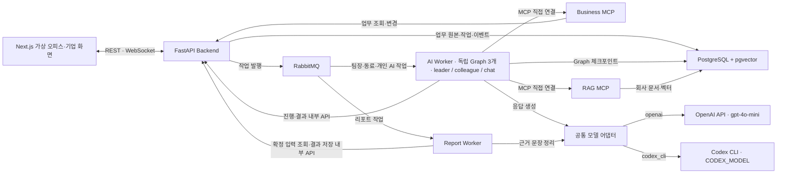

> **Day Zero**는 입사 첫날(Day 1) 전에 팀과 함께 일해 보는 날이라는 뜻입니다. 이 문서는 **무엇을 왜 만드는지**를 정리한 공통 기획서이고, 맨 아래 부록의 기술 설계는 참고용입니다.

## 1. 한 줄 정의

지원자가 **가상 업무용 PC의 메신저 / AI 채팅 / 업무·제출 앱**을 자유롭게 오가며 **AI 팀원과 2시간 동안 공통 과제를 수행**하고, 기업은 **최종 결과물의 품질과 협업·프롬프트·수정 과정**을 업무 수행 역량·AI 활용 역량·협업 태도 세 축의 근거 리포트로 받는 B2B2C 채용 평가 서비스입니다.

- **핵심 가치**: 실제 과제의 수행 과정과 결과를 근거로 면접·자기 보고식 검사를 보완합니다. 요구사항을 반영하는 방식, AI를 활용하는 판단, 동료와 상황을 조율하는 행동을 관찰합니다.
- **화면·에이전트·분석의 구분**: 상단 앱은 메신저 / AI 채팅 / 업무·제출입니다. 메신저에는 독립된 팀장·동료 에이전트가 참여하고 개인 AI는 별도 에이전트로 실행합니다. 세 에이전트의 기억·상태·권한을 분리하며, 같은 과제의 과정과 결과를 세 평가 축으로 연결합니다. 사용자 상호작용은 AI 동료 협업과 개인 AI 채팅의 두 흐름으로 유지합니다.
- **왜 리모트인가**: 리모트 협업은 메시지 하나하나에 태도가 남습니다. 텍스트 기록이 곧 평가 근거가 됩니다.
- **AI의 역할**: AI 동료는 담당 업무·약속·진행 상태를 가지고 먼저 질문하고, 이견을 조율하며, 실제 작업물을 작성하는 팀원입니다. AI 채팅은 지원자의 요청에 응답하는 개인 업무 도구입니다. 서비스는 행동과 결과의 근거를 기록하고, 최종 판단은 기업의 채용 담당자가 합니다.
- **공통 목표, 자유로운 접근**: 같은 시나리오 버전의 목표·제출 조건·시간·자료·핵심 상황·분석 기준은 같고, 세부 태스크·작업 순서·분업·AI 사용 방식은 지원자가 선택합니다.

## 2. 문제

기업은 지원자가 과제를 수행하고, AI를 활용하고, 동료와 협업하는 모습을 알고 싶지만, 기존 도구는 지원자의 자기 보고와 짧은 면접에 의존하는 경우가 많습니다. 그 결과 기업은 "뽑고 나서야 알게 되는" 채용 실패를 반복하고, 지원자는 자신을 제대로 보여주지 못한 채 왜 떨어졌는지도 모르고 끝납니다.

### 문제 1. 기업이 원하는 것과 측정하는 것이 다르다

- 사람인 조사에서 인사담당자는 면접 평가 항목으로 직무 경험(68.4%) 다음으로 **성실성과 책임감(60.6%)**을 꼽았습니다. 인성·가치관(36.8%), 조직 융화력(24.9%)도 상위권입니다. ([인사이트](https://www.insight.co.kr/news/168597))
- 같은 조사에서 실제 면접 유형은 질의응답 면접이 94.1%였고, 실무 수행 면접은 10.7%에 그쳤습니다. 말로 묻고 말로 답하는 방식이 대부분입니다.
- 해외도 같습니다. LinkedIn 조사에서 인재 담당자 91%가 소프트 스킬이 중요하다고 했지만, 이를 평가하는 공식 절차가 있는 회사는 41%뿐이었습니다. ([LinkedIn](https://business.linkedin.com/talent-solutions/blog/talent-on-tap/2019/linkedins-head-of-recruiting-weighs-in-on-the-top-talent-trends-2019))

### 문제 2. 자기 보고식 인성검사는 꾸밀 수 있다

- 대기업 인성검사는 수백 문항입니다. 현대차그룹 HMAT 인성검사는 155문항과 300문항, 최대 110분으로 구성됩니다. ([링커리어](https://community.linkareer.com/employment_data/6538867))
- 지원자 사이에서는 인성검사를 "정답을 맞히는 시험"으로 여기고 대비법이 공유됩니다.
- 인사담당자 83.8%가 지원자의 거짓말을 판단한 경험이 있고, 거짓말이 가장 잘 드러나는 전형으로 실무면접(65.5%)을 꼽았습니다. 인적성 검사는 2.4%였습니다. ([뉴스토마토](https://newstomato.com/ReadNews.aspx?no=983028)) **실제로 일을 시켜봐야 진짜 모습이 보인다**는 뜻입니다.

### 문제 3. 잘못된 채용은 비싸고, 작은 팀일수록 더 아프다

- 2025년 인크루트 조사(인사담당자 446명)에서 조기 퇴사 사유 1위는 직무 적합성 불일치(58.9%)였고, 인사담당자 60.9%가 최근 1년 안에 신입 조기 퇴사를 경험했습니다. ([Korea Business Review](https://www.koreabizreview.com/articles/kbr-legacy-7240))
- 북미 444개 조직 조사에서 42%가 잘못된 채용의 비용을 연봉의 2배로 추산했습니다. ([PLANSPONSOR](https://www.plansponsor.com/bad-hires-a-big-cost-to-employers/)) Robert Half 조사에서는 채용 관리자 60%가 잘못 뽑은 직원이 동료와 잘 지내지 못한다고 답했습니다. ([SHRM](https://shrm.org/topics-tools/news/talent-acquisition/morale-productivity-suffer-bad-hires))
- 작은 회사도 예외가 아닙니다. 영국 Indeed 조사(사업주 1,000명)에서 직원 1~49명 기업은 한 해 평균 3명을 잘못 뽑을 것으로 예상했습니다. ([Startups.co.uk](https://startups.co.uk/news/small-business-hiring-regret/)) 몇 명이 일하는 스타트업에서는 한 명의 협업 문제가 팀 전체의 속도를 좌우합니다.

### 문제 4. 지원자는 자신을 보여줄 기회도, 떨어진 이유도 얻지 못한다

- 잡코리아 2019년 조사에서 취업준비생 1,862명 중 51.5%가 최종 면접 후 불합격한 기업으로부터 **통보조차 받지 못했다**고 답했습니다. 같은 해 인사담당자 364명 중 61%는 불합격자에게 따로 통보하지 않는다고 했습니다. ([Korea Business Review](https://www.koreabizreview.com/articles/kbr-news-issue-briefing-100-20260822-15zs))
- 채용 여부를 알리도록 한 채용절차법 제10조는 직접적인 제재 규정이 없고, **상시 30명 미만 사업장에는 적용되지 않습니다.** 대부분의 스타트업이 여기에 해당합니다. (같은 기사)
- 결과를 알더라도 이유는 남지 않습니다. 짧은 면접과 검사 점수로 내린 판단은 지원자에게 "무엇을 보고 어떻게 판단했는지" 설명하기 어렵습니다.
- 그래서 지원자는 실제로 일을 잘하는 사람이어도 말로 자신을 증명해야 하고, 떨어져도 무엇을 고쳐야 할지 모릅니다. **행동 근거로 평가하면 평가 자체가 더 정확해지고, 그 근거를 지원자에게 돌려줄 수도 있습니다.**

### 근거: 행동 관찰이 자기 보고보다 예측력이 높다

선발 도구 연구의 고전인 Schmidt & Hunter(1998) 메타분석에서 업무 샘플 테스트의 성과 예측 타당도는 0.54로, 성격검사 중 성실성(0.31)보다 높았습니다. ([Plum](https://www.plum.io/blog/schmidt-hunter-meta-analysis)) 다만 2016년 재분석에서는 0.33으로 낮아져, **시뮬레이션이 실제 업무를 얼마나 잘 반영하느냐**가 품질을 결정한다는 점도 함께 기억해야 합니다. ([Test Partnership](https://www.testpartnership.com/blog/measure-quality-hire.html))

## 3. 왜 지금인가

- **리모트 근무가 자리 잡았다.** 미국 노동통계국 조사에서 2025년 전일제 근로자의 34.9%가 평균적인 하루에 업무 일부를 집에서 했고, 2024년(33.4%)보다 늘었습니다. ([Bloomberg Law](https://news.bloomberglaw.com/new-york-brief/more-people-worked-from-home-in-2025-despite-rto-mandates)) 리모트 팀에서는 텍스트로 보고하고, 먼저 공유하고, 비동기로 조율하는 능력이 성과를 가르지만 대면 면접으로는 이 행동을 볼 수 없습니다.
- **AI와 함께 일하는 능력이 새 필수 역량이 되었다.** 해외 평가 기업들은 AI 협업 균형을 평가해야 할 핵심 역량으로 제시합니다. ([Canditech](https://www.canditech.io/blog/category/uncategorized/)) 그런데 기존 채용 절차는 AI 사용을 막거나 무시할 뿐, 잘 쓰는지를 보지 않습니다.
- **서류의 변별력이 떨어지고 있다.** 생성형 AI로 자기소개서가 평준화되고 있습니다. ([한국경제](https://www.hankyung.com/article/202607305840H))

## 4. 타깃

| 구분 | 정의 | 이유 |
|---|---|---|
| 핵심 고객 (구매자) | **리모트 중심 스타트업** | 메신저·문서 기반 가상 업무가 실제 근무 환경과 거의 같음. 작은 팀이라 한 명의 협업 문제가 크고, 자체 인적성 검사를 운영할 여력이 없음 |
| 평가 대상 (사용자) | **주니어 지원자 (신입~3년차)** | 이력서·포트폴리오·레퍼런스로 협업 방식을 가늠하기 가장 어려운 층. 서비스 기획 과제 난이도와 맞음 |

### 이해관계자와 이득

돈을 내는 쪽은 기업(B2B), 서비스를 직접 경험하는 쪽은 지원자(C)입니다. 두 쪽 모두 이득이 있어야 B2B2C 구조가 성립합니다.

| 이해관계자 | 지금의 고통 | Day Zero가 주는 이득 |
|---|---|---|
| 스타트업 대표·채용 담당 (구매자) | 면접만으로는 협업 태도를 확인하기 어렵고, 잘못된 채용 한 번이 팀 전체를 흔듦 | 실제 행동 근거가 담긴 리포트로 면접 질문을 준비하고, 판단 근거를 팀에 설명할 수 있음 |
| 팀 리드·실무 면접관 | 함께 일해봐야 아는데 인턴십·트라이얼을 운영할 여력이 없음 | 팀원으로서, 그리고 AI를 쓰는 동료로서 어떻게 일할지 미리 봄 |
| 지원자 | "정답"을 추측해야 하는 검사, 짧은 면접에서 자신을 보여주기 어려움 | 말이 아닌 행동으로 자신을 증명. 평소처럼 AI를 쓰며 일할 수 있고, 리모트 업무를 미리 체험 |
| 지원자 (탈락자) | 통보도, 이유도 받지 못함 | 디브리핑으로 어떤 상황이 있었는지 알 수 있음. 기업 동의 시 행동 근거 피드백 (MVP 이후) |
| 대학·취업 지원 기관 | 소프트 스킬과 AI 활용을 가르쳐도 측정할 방법이 없음 | 연습 모드로 협업·AI 활용 역량 진단 (확장 시장) |

## 5. 솔루션

지원자는 가상 업무용 PC에서 **2시간 동안 "압축된 하루"**를 보냅니다. 상단의 **메신저 / AI 채팅 / 업무·제출** 앱을 원하는 순서로 전환합니다. 메신저에서는 팀원과 이야기하며 업무를 나누고, AI 채팅에서는 개인적으로 도움을 받고, 업무·제출에서는 태스크·자료·기획안을 다룹니다. 세 앱은 하나의 세션·공통 과제·최종 제출물을 공유합니다.

| 구분 | 흐름 1: AI 동료 협업 | 흐름 2: AI 채팅 |
|---|---|---|
| 목적 | 팀원과 함께 일하는 행동 관찰 | AI를 업무 도구로 활용하는 행동 관찰 |
| 상대 | AI 동료와 팀장 | 업무용 AI 어시스턴트 |
| 시작 방식 | 동료·팀장이 먼저 말을 걸거나 지원자가 메시지를 보냄 | 지원자가 요청할 때 응답 |
| 주요 활동 | 분업, 도움 요청 대응, 진행 공유, 요구사항 조율, 상호 리뷰 | 질문, 자료 요약, 아이디어 제안, 초안 작성, 정책 확인 |
| 관찰 요소 | 책임감, 존중·소통, 협력 태도, 유연성 | 위임 판단, 맥락 전달, 결과 검증 |

AI 동료 협업은 세션의 기본 진행 흐름이며, AI 채팅은 세션 내내 선택적으로 사용할 수 있습니다. AI 채팅을 쓰는 동안에도 협업 이벤트는 같은 시점에 진행됩니다. AI 채팅의 결과를 검토해 동료에게 공유하거나 기획안에 반영하는 과정도 근거로 연결합니다.

두 사용자 흐름은 협업과 개인 AI 활용의 구분이고, 세 앱은 화면 구성, 세 평가 축은 분석 기준입니다. **팀장·동료·개인 AI는 각자 기억·목표·실행 상태·도구 권한을 가진 독립 에이전트 3개**입니다. 메신저에서 팀장과 동료가 같은 대화에 참여해도 인물이나 상태를 교체하지 않습니다. 업무·제출 앱은 공통 작업 화면입니다. 기존 기능 ID 32개와 우선순위(P0 27개·P1 4개·선택 1개), 과제와 네 핵심 이벤트는 유지합니다.

### 5.1 구성 요소

| 구성 요소 | 역할 |
|---|---|
| AI 동료 | 맡은 일과 진행 상태를 기억하고 질문·대안·조율·리뷰를 주고받음. 담당 태스크와 문서의 실제 변경을 근거로 진행을 공유하고 공통 상황에도 참여 |
| 팀장 | 독립된 보고·확인 이력을 가진 에이전트. Backend가 공개한 과제·요구사항을 안내하고 질문·진행 확인·최종 보고에 응답. 동료의 담당 작업은 수행하지 않음 |
| **AI 채팅** | 지원자의 요청에 응답하는 업무용 AI 어시스턴트. 질문, 자료 요약, 아이디어 제안, 초안 작성에 회사 문서를 참고함 |
| 가상 업무용 PC | 상단 세 앱 전환과 앱별 작업 영역. 메신저의 채널·DM, 독립 AI 채팅, 업무·제출의 태스크·기획안·회사 자료. 시간과 저장 상태는 공통으로 표시. 텍스트 중심 |
| 관찰 기록 | 두 흐름의 대화를 구분해 저장하고, 시점·분업 결정·문서 변경 이력·AI 채팅 결과 활용을 같은 세션에 연결 |
| 근거 리포트 | 최종본을 공통 품질 기준과 대조하고, 협업·프롬프트·작업 이력을 세 축으로 연결. 결과물의 품질 근거와 지원자·동료·AI의 기여를 구분. 합격·불합격 판정은 하지 않음 |

#### 5.1.1 미니 PC의 화면 계약

| 상단 앱 | 기본 화면과 동작 |
|---|---|
| 메신저 | 시작 시 기본 앱. 좌측에 팀 채널·동료 1:1 목록, 중앙에 선택한 대화와 입력창. 팀장은 팀 채널에서 공지·보고를 주고받음 |
| AI 채팅 | 개인 AI 도구의 독립 대화·입력창·참고 자료. 답변을 검토해 메신저나 기획안으로 옮기는 행동은 지원자가 선택 |
| 업무·제출 | 내부에서 태스크·공유 기획안·회사 자료를 열고 편집. 최종 제출 영역에서 저장 상태와 최종본을 확인하고 제출 |

- 한 번에 선택한 앱이 주 작업 영역을 사용합니다. 대화 옆에 문서·태스크를 항상 나열하는 기존 2열 화면을 교체합니다.
- 앱·채널을 바꿔도 각 입력 초안, 대화 위치, 편집 중 문서, 진행 중 요청을 유지합니다. 메신저와 AI 채팅의 입력을 별도로 보존합니다.
- 다른 앱을 사용해도 메신저의 새 메시지 알림·미확인 표시가 도착합니다. 알림 전달과 실제 대화 읽기는 구분하며, 탭 클릭 횟수를 역량 지표로 사용하지 않습니다.
- 남은 시간과 문서 저장·오류 상태를 공통 표시합니다. 최종 제출은 업무·제출 앱에서 확인하고, 제출 전 마지막 문서 저장을 완료합니다.
- MVP의 PC 경험은 웹 안의 앱 전환으로 구현합니다. 창 이동·크기 조절, 파일 탐색기, 브라우저·셸 실행을 추가하지 않습니다. 활성 세션 내 앱 상태 보존은 P0이며, 브라우저 재입장의 완전한 복원은 F-19(P1)과 구분합니다.

#### 5.1.2 AI 팀원의 티키타카와 실제 업무

동료는 지원자의 말에 따라 질문·수락·대안 제시·일정 조율·작업 수행을 이어갑니다. 대화에서 정한 일은 태스크와 문서로 연결되고, 다음 대화에는 합의와 실제 진행 상태가 반영되어야 합니다.

| 행동 | 요구 동작 |
|---|---|
| 먼저 소통 | 맡은 일이 생김, 공개 자료가 도착함, 약속한 확인 시점이 됨, 작업이 완료됨 등의 업무 계기로 질문·진행 공유. 고정 이벤트와 구분해 계기를 기록 |
| 질문과 이견 | 불명확한 목표를 확인하고 자료·범위에 근거한 대안을 제시. 지원자의 수락·거절·보류·대안을 다음 행동에 반영. 특정 답을 유도하는 추가 갈등은 만들지 않음 |
| 실제 작업 | 합의한 담당 범위의 세부 태스크를 수행하고 기획안을 작성·수정. 저장된 버전·태스크 상태를 확인한 뒤 완료를 알림 |
| 기억과 후속 행동 | 결정·미해결 질문·다음 행동·지원자와의 약속을 유지. 새 요청이나 변경 공지를 받으면 현재 계획과 대조해 조율 |

일반 진행 공유는 동일한 업무 계기·대상 버전당 한 번만 생성하며, 의미 없는 주기적 발화를 만들지 않습니다. 10분 무응답 확인은 별도 P1인 F-25로 유지합니다. AI 동료는 개인 AI 채팅을 열람하지 않으며 지원자가 실제로 공유한 내용만 협업 맥락으로 받습니다.

팀장·동료·개인 AI의 대화 요약·결정·약속·처리 중 작업은 에이전트별로 저장합니다. 팀 채널·공유 기획안·태스크·공개 자료는 권한에 맞게 같은 업무 원본을 조회하고, 개인 AI의 비공유 대화와 동료 DM을 팀장에게 넘기지 않습니다. 팀장과 동료의 수신자·멘션·답글·업무 계기에 따라 응답자를 정하며, 한 메시지에 세 에이전트를 모두 호출하지 않습니다. 상세 상태·권한 계약은 A.4를 따릅니다.

예: 동료가 "인터뷰 근거 정리는 제가 맡을게요. 대상이 첫 참여자인가요?"라고 묻고, 지원자가 변경된 대상을 설명하면 동료는 자료의 적용 범위를 확인하고 필요한 확인 작업을 제안합니다. 지원자가 태스크 등록을 요청하거나 합의하면 실제 카드가 생기고, 동료가 근거 정리를 저장한 뒤 해당 문서와 함께 진행을 공유합니다. 이 대화는 예시이며 필수 정답 경로가 아닙니다.

### 5.2 2시간 세션 흐름 (서비스 기획 과제)

과제는 기존과 동일한 **신규 기능 기획안 작성**입니다. 가상 회사, 과제, 이벤트의 구체 내용은 [6. 공통 시나리오](#6-공통-시나리오)에 있습니다. AI 채팅은 세션 내내 쓸 수 있습니다. 업무 수행 역량의 관찰 범위는 이 기획 과제에서 보인 수행으로 한정하며, 다른 직무의 적성으로 일반화하지 않습니다.

| 시점 | 장면 | 관찰하는 요소 |
|---|---|---|
| 00:00 | **킥오프**: 팀장이 과제와 마감을 공지하고 AI 동료가 인사 | — |
| 00:10 | **분업**: AI 동료가 분담안을 제안하고 지원자가 수락하거나 다시 나눔 | — (흐름용) |
| 00:30 | **도움 요청**: 지원자가 바쁠 때 동료가 도움을 청함 | 협력 태도 |
| 00:50 | **지연 발생**: 지원자 파트에 필요한 인터뷰 자료가 늦게 도착 | 책임감 |
| 01:10 | **요구사항 변경**: 팀장이 기획 대상 사용자를 바꿈 | 유연성 |
| 01:30 | **상호 리뷰**: 동료 파트에 회사 정책과 어긋나는 내용이 들어 있음 | 존중·소통 |
| 01:50 | **마감·보고**: 기획안을 내고 팀장에게 보고 | — |
| 세션 전체 (지원자 요청 시) | **AI 채팅**: 자료 요약, 아이디어 제안, 초안 작성 등을 요청하고 결과를 검토·활용 | AI 활용 |

업무 수행 역량은 위 일정 전체에서 요구사항이 기획안에 반영되는 과정과 제출물을 근거로 관찰합니다. 이를 위한 추가 이벤트는 만들지 않습니다.

모든 지원자는 **같은 시점에 같은 핵심 상황**을 겪습니다. 일반 업무 대화·태스크·후속 행동은 지원자의 선택과 실제 작업에 맞게 달라집니다. 핵심 상황의 종류·시점·정보량·난이도는 변경하지 않습니다.

### 5.3 MVP에서 관찰하는 세 평가 축

**1. 업무 수행 역량 — 기존 과제 수행 과정과 제출물**

| 관찰 항목 | 보는 것 | 근거 |
|---|---|---|
| 요구사항 반영 | 변경된 대상 사용자와 회사 정책을 기획안에 어떻게 반영했는지 | 과제 브리프, 요구사항 변경 메시지, 기획안 수정 이력 |
| 근거 활용 | 회사 문서의 수치·인터뷰 내용을 문제 정의와 기능 제안에 어떻게 연결했는지 | 회사 문서와 지원자가 작성·수정한 문장 |
| 실행 가능성 | 제안의 범위·실행 단계·일정과 운영 제약의 관계를 어떻게 설명했는지 | 기획안, 태스크와 분업 조정 기록 |

MVP는 최종본의 요구사항 충족·근거 정확성·내용의 일관성·실행 계획을 위 세 항목에 연결해 분석하고, 수정 과정을 함께 제시합니다. 실행 가능성은 계획에 적힌 범위·단계·제약 근거로 한정하며 실제 구현 가능성이나 사업 성공 여부를 AI가 판정하지 않습니다. 결과물 전체의 품질 근거와 지원자가 기여한 행동은 구분합니다. AI를 사용할 수 있는 환경의 수행이며, 동료 작성 파트와 AI 초안은 지원자의 검토·수정·공유 이력과 함께 표시합니다.

**2. AI 활용 역량 — AI 채팅 사용 과정**

별도 이벤트를 만들지 않고, 지원자가 세션 내내 AI 채팅을 쓰는 방식을 관찰합니다.

| 관찰 항목 | 보는 것 |
|---|---|
| 위임 판단 | 어떤 일을 AI에 맡기고 어떤 일을 직접 했는지 |
| 맥락 전달 | 요청에 과제 목표, 회사 정책 같은 조건을 담았는지 |
| 결과 검증 | AI 결과를 회사 문서와 대조하거나 고쳐 썼는지, 그대로 붙여 넣었는지 |

AI 채팅을 쓰지 않은 것 자체는 감점 요소가 아니며, 리포트의 AI 활용 역량에는 "사용하지 않음"으로만 표시합니다. 이 경우 AI 활용 역량을 판단할 근거가 없다는 뜻이며, 업무 수행 역량과 협업 태도는 남아 있는 기록으로 정리합니다.

**3. 협업 태도 — AI 동료 협업의 이벤트 대응**

| 관찰 항목 | 상황 | 관찰 포인트 |
|---|---|---|
| 책임감 | 맡은 일이 예상보다 늦어짐 | 마감 전에 먼저 공유하는지, 조용히 넘기는지 |
| 존중·소통 | AI 동료의 실수 | 지적하는 말투가 비난 중심인지 해결 중심인지 |
| 협력 태도 | 내 일이 바쁠 때 동료의 도움 요청 | 무시, 도움, 또는 우선순위 조율 제안 |
| 유연성 | 막판 요구사항 변경 | 불만 표현 방식, 일정·범위를 다시 잡는 능력 |

AI 채팅에서 생성된 답변과 지원자가 실제로 동료에게 보낸 메시지를 구분하며, 채팅에만 남은 초안을 협업 태도의 근거로 기록하지 않습니다. 세 축은 같은 장면의 서로 다른 행동을 보여주며, 합산 점수나 종합 인성 판정을 만들지 않습니다.

MVP 이후 후보: **공정성**(분업이 균형 잡혔는지), **정직성**(보고할 때 동료 기여를 인정하는지), **리모트 협업**(먼저 보고하는 빈도, 정리된 글쓰기). 핵심 고객이 리모트 스타트업이므로 리모트 협업이 다음 순위 후보입니다.

### 5.4 기존 방식과의 차이

- **자기 보고 → 행동 관찰**: "나는 이렇게 한다"가 아니라 실제로 한 행동을 봅니다.
- **정답 맞히기 → 상황 대응**: 지원자에게는 업무 과제만 보이고 상황은 자연스럽게 일어나므로 꾸미기 어렵습니다.
- **AI 금지 → AI 활용 관찰**: AI 사용을 막지 않고, 실제 업무처럼 AI와 함께 일하는 방식을 봅니다.
- **점수 → 근거**: 리포트는 "책임감 4점" 대신 "00:52 인터뷰 자료 지연을 마감 전에 팀장에게 먼저 알리고 대안을 제시함"처럼 실제 대화를 근거로 보여줍니다.
- **무응답 → 설명**: 지원자는 종료 후 어떤 상황이 연출되었는지 디브리핑을 받습니다.

### 5.5 지켜야 할 원칙

1. **AI는 관찰하고, 사람이 판단한다.** 합격·불합격, 점수, 순위를 만들지 않습니다.
2. **목표·조건·기준은 같고 접근은 자유롭다.** 같은 시나리오 버전에서는 목표·최종 제출 조건·시간·자료와 공개 시점·핵심 상황·AI 기본 역할과 제공 한도·분석 기준을 고정합니다. 세부 태스크·작업 순서·분업·대화·AI 사용 여부로 정답 경로를 정하지 않습니다.
3. **형식은 알리고, 상황은 알리지 않는다.** AI 동료 협업과 AI 채팅 두 흐름의 역할, 관찰 항목, 두 흐름의 대화와 결과 활용이 기록된다는 점, 사람이 최종 판단한다는 점은 미리 알리고 동의를 받습니다. 구체적인 돌발 상황만 비공개입니다.
4. **끝나면 설명한다.** 종료 후 "연출된 상황이 있었다"는 디브리핑을 제공합니다.
5. **필요한 정보만 다룬다.** 지원자 실명 대신 별칭을 쓰고, 대화 기록의 보관 기간을 명시합니다.
6. **관찰한 범위 안에서 설명한다.** 업무 수행 역량·AI 활용 역량·협업 태도를 구분하고, 한 세션으로 지원자의 전반적인 인성·적성이나 AI 없이 일하는 능력을 단정하지 않습니다.

## 6. 공통 시나리오

모든 팀원의 MVP는 **아래 시나리오를 그대로** 씁니다. 같은 조건으로 돌려야 결과를 비교할 수 있습니다. 회사, 서비스, 수치는 모두 가상입니다.

### 6.1 가상 회사

| 항목 | 내용 |
|---|---|
| 회사 | **루프랩** (12명, 전원 리모트 근무 스타트업) |
| 서비스 | **모아런**: 동네 러닝 모임을 찾아 함께 뛰는 앱. 출시 1년, 월 사용자 3만 명 |
| 협업 방식 | 메신저로 소통하고, 공유 문서로 작업하며, 태스크 보드로 진행 상황을 관리. 업무에 AI 채팅을 자유롭게 씀 |
| 지금의 고민 | 처음 모임에 나온 사용자 중 두 번째 모임에도 나오는 비율이 22%에 그침 |
| 등장인물 | **한서윤 팀장** (프로덕트 팀장), **AI 동료 이도현** (입사 2년 차 기획자), **지원자** (오늘 합류한 같은 팀 기획자) |

### 6.2 과제 브리프

팀장이 킥오프에서 전달하는 내용입니다.

> 첫 모임에 나온 사용자가 **두 번째 모임에도 다시 나오게 만드는 신규 기능**을 기획해 주세요. 2시간 뒤 2~3쪽 기획안을 공유 문서로 받겠습니다. 필요하면 AI 채팅을 써도 됩니다.

| 기획안 구성 | 기본 담당 (동료의 분담안) |
|---|---|
| 1. 문제 정의와 대상 사용자 | 지원자 |
| 2. 사용자 인터뷰에서 찾은 근거 | 지원자 |
| 3. 핵심 기능 제안 | 지원자 + 동료 |
| 4. 비슷한 서비스 사례 | 동료 |
| 5. 성공 지표와 출시 일정 | 동료 |

다섯 파트는 공통 제출물의 구성입니다. 태스크 개수를 다섯 개로 제한하지 않습니다. 지원자와 동료는 각 파트에 연결된 세부 태스크를 만들고 담당·순서를 조율할 수 있으며, 어떻게 나누든 이후 이벤트는 같은 시점에 일어납니다.

지원자는 00:10 전에 먼저 업무를 논의할 수도 있습니다. 00:10의 기본 분담안은 제안 기회이며, 이미 합의했다면 기존 합의를 확인합니다. 초기 분업 제안·조정은 최대 3회로 유지하되 대화 횟수를 제한하지 않습니다. 합의 후에도 요구사항 변경이나 명시적 재조율에 따라 태스크·담당을 바꿀 수 있으며, 공통 목표·마감·핵심 이벤트는 바뀌지 않습니다.

#### 공통 완료 조건과 자유로운 접근

| 모두에게 공통 | 지원자가 선택할 수 있는 것 |
|---|---|
| 변경 공지 이후의 대상·목표, 다섯 파트의 최종 기획안, 2~3쪽을 목표로 하는 작성 안내, 120분 마감 | 제안 기능과 해결 가설, 자료를 확인하는 순서, 파트별 작성 분량 |
| 회사 정책·동일 버전 자료·공개 시점·네 핵심 이벤트 | 세부 태스크 개수·내용·수행 순서·담당, 동료와의 조율 방식 |
| 에이전트/리포트별 같은 고정 모델 바인딩·동료 기본 역할·도구 권한·제공 한도와 분석 기준 버전 | 개인 AI 사용 여부, 요청·후속 질문·답변 수정·활용 방식 |

특정 기능 아이디어·모범 프롬프트·대화 문구·태스크 분해를 정답으로 두지 않습니다. 표준 품질 기준은 요구사항 반영·근거 활용·실행 가능성이고, 핵심 조건에 맞는 서로 다른 해법을 동일한 기준으로 읽습니다. 동일 조건 제공만으로 공정성이 입증됐다고 하지 않으며, 생성 응답 차이·장애·자료 전달 여부도 비교의 한계로 남깁니다.

### 6.3 회사 문서

지원자와 팀장·동료·개인 AI가 작업 중에 찾아볼 수 있는 문서입니다. 세 에이전트는 답할 때 어느 문서를 근거로 했는지 함께 밝힙니다. 같은 문서 공개 시점을 적용하며 아직 공개되지 않은 인터뷰 요약은 어느 에이전트에도 제공하지 않습니다.

| 문서 | 담긴 내용 | 시나리오에서의 역할 |
|---|---|---|
| 회사·서비스 소개 | 루프랩과 모아런 소개, 핵심 기능, 주요 사용자 | 배경 이해 |
| 지표 현황 | 월 사용자, 첫 참여 후 재참여율 22%, 모임 규모별 재참여율 | 문제 정의 근거 |
| 사용자 인터뷰 요약 | 첫 참여자 8명 인터뷰. "아는 사람이 없어 어색했다", "다음 모임 일정을 놓쳤다" 등 | 지원자 파트의 핵심 자료. **00:50 지연 알림 후 01:05에 공개** |
| 운영 정책 | **올해는 유료 기능을 출시하지 않음**, 위치 정보는 동네 단위까지만 공개 | 상호 리뷰에서 동료의 오류를 알아챌 근거 |
| 지난주 회의록 | 재참여율 문제를 이번 분기 최우선 과제로 정한 회의 | 과제의 배경과 우선순위 |

### 6.4 이벤트 4개

이벤트의 **종류와 시점, 전달할 내용**은 고정입니다. 실제 문장은 AI 동료와 팀장이 대화 흐름에 맞게 자연스럽게 바꿔 말합니다.

| 시점 | 협업 태도 항목 | 누가 | 상황 | 관찰하는 행동 |
|---|---|---|---|---|
| 00:30 | 협력 태도 | AI 동료 | "비슷한 서비스 사례를 찾는데 기준이 헷갈려요. 10분만 같이 봐줄 수 있을까요?" | 돕는지, 거절하는지, 자기 일정과 조율해 언제 도울지 제안하는지 |
| 00:50 | 책임감 | 시스템 알림 | 사용자 인터뷰 요약이 리서치 담당자 사정으로 15분 늦게 공유된다는 알림. 지원자 파트(2번)가 이 자료에 달려 있음 | 마감 전에 팀장이나 동료에게 지연을 먼저 알리는지, 대안(먼저 할 수 있는 부분부터 진행 등)을 내는지 |
| 01:10 | 유연성 | 팀장 | "대표님과 이야기해 보니 대상을 바꿔야겠어요. 첫 참여자 말고 **3개월 넘게 모임에 안 나온 사용자**로 가 주세요. 마감은 그대로예요." | 불만을 어떻게 표현하는지, 범위·분담을 다시 정하자고 제안하는지, 바뀐 방향을 기획안에 반영하는지 |
| 01:30 | 존중·소통 | AI 동료 | 동료가 자기 파트를 공유하는데, 핵심 기능에 **"재참여 시 할인되는 유료 멤버십"**이 들어 있음. 운영 정책(올해 유료 기능 없음)과 어긋남 | 오류를 알아채는지, 지적이 비난 중심인지 해결 중심인지, 근거(운영 정책)를 함께 제시하는지 |

**모든 지원자에게 같은 것**: 이벤트 4개의 시점·핵심 정보·검토 기회, 회사 문서와 공개 시점, 과제 브리프, 최종 완료 조건, AI 기본 역할·제공 한도, 분석 기준 버전.
**지원자마다 달라질 수 있는 것**: 실제 대화·질문·반론·합의, 세부 태스크와 작업 순서, 분업 결과, AI 채팅 사용 방식, 기획안 내용.

현재 분업과 다른 상황을 사실처럼 만들지 않습니다. 도움 요청은 공통 사례 비교 기준의 검토 요청으로 유지하고 현재 작업과 연결합니다. 자료 지연은 같은 자료의 공개 지연으로 알리되 누구의 태스크에 영향이 있는지는 실제 상태로 표시합니다. 01:30의 정책 충돌 제안은 **별도 동료 리뷰 초안**으로 모든 지원자에게 제공하며, 이미 작성한 지원자·공동 기획안을 강제로 덮어쓰지 않습니다. 이미 같은 오류를 지적한 지원자에게도 같은 검토 기회를 제공하고 앞선 대화를 후속 응답에 반영합니다.

## 7. 사용자 흐름

### 7.1 전체 흐름

프런트엔드 진입은 **개인**과 **기업 관계자** 두 영역으로 구분합니다. 개인은 초대 링크로 업무 공간에 입장합니다. 기업 관계자는 로그인 후 지원자 관리와 완료자 보고서 목록을 이용하고, 각 완료자의 독립된 보고서 상세 페이지에서 최종본·과정·원문을 확인합니다. 완료 후 생성 중·준비됨·실패 상태도 구분합니다. 개인 업무 공간 안의 상단 세 앱과 외부의 두 사용자 영역은 별개의 구분입니다.

기업과 지원자가 주고받는 순서입니다. 지원자는 초대 링크로만 들어오고, 기업은 리포트만 받습니다.

1. **기업 관리자**: 로그인 → 지원자 초대 → 초대 링크가 지원자에게 전달됨
2. **지원자**: 링크 입장 → 안내·동의 → 2시간 세션에서 AI 동료 협업 + 필요 시 AI 채팅 활용 → 제출 → 디브리핑
3. **서비스**: 두 흐름과 과제 수행의 근거 기록 → 세션이 끝나면 업무 수행 역량·AI 활용 역량·협업 태도 리포트 생성 → 기업에 "리포트 준비됨" 표시
4. **기업 관리자**: 리포트 확인 → 면접에서 근거를 확인하고 최종 판단

### 7.2 기업 관리자 흐름

| 단계 | 화면 | 하는 일 | 다음 |
|---|---|---|---|
| 1 | 로그인 | 이메일과 비밀번호로 로그인 | 지원자 목록 |
| 2 | 지원자 목록 | 지원자별 상태(초대됨 · 진행 중 · 완료 · 리포트 준비됨 · 실패)를 확인 | 초대 또는 리포트 |
| 3 | 지원자 초대 | 지원자 별칭과 이메일을 입력하고 초대 링크를 만듦 | 지원자 목록 (상태: 초대됨) |
| 4 | 완료자 보고서 목록·개별 상세 | 업무 수행 역량·AI 활용 역량·협업 태도 세 축의 상황 · 관찰 내용 · 근거를 읽고, 대화 근거를 누르면 해당 흐름의 대화로 이동 | 면접 준비 |

### 7.3 지원자 흐름

| 단계 | 화면 | 하는 일 | 다음 |
|---|---|---|---|
| 1 | 링크 입장 | 초대 링크를 열면 회사 이름과 소요 시간(2시간)이 보임 | 안내·동의 |
| 2 | 안내·동의 | AI 동료 협업·AI 채팅의 역할, 세 평가 축(업무 수행 역량·AI 활용 역량·협업 태도), 과제 수행·두 흐름의 대화 및 결과 활용 기록, AI 채팅 사용은 선택이라는 점, 사람이 최종 판단한다는 점을 읽고 동의 | 시작 대기 |
| 3 | 시작 대기 | 가상 회사와 팀원 소개를 읽고 준비되면 시작 | 가상 오피스 |
| 4 | 가상 업무용 PC | 메신저를 기본으로 열고 세 앱을 자유롭게 전환. 동료와 업무를 조율해 태스크를 만들고, AI 채팅·자료·기획안을 필요에 따라 사용. 앱을 바꿔도 입력·작업 상태와 메시지 알림 유지 | 업무·제출 |
| 5 | 업무·제출 | 저장 상태·최종 기획안·태스크를 확인하고 제출. 팀장 보고는 메신저에서 진행하며, 2시간이 지나면 서버가 마지막 저장본을 자동 제출 | 디브리핑 |
| 6 | 디브리핑 | 연출된 상황 4개가 무엇이었는지와, 리포트는 기업에 전달되고 사람이 판단한다는 안내를 봄 | 종료 |

### 7.4 세션 안의 두 흐름

| 흐름 | 반복되는 순서 | 기록 |
|---|---|---|
| AI 동료 협업 | 동료·팀장 메시지 또는 이벤트 → 지원자의 응답·분업 조율·업무 진행 → 공유·리뷰 | 협업 대화, 응답 시점, 분업 결과, 태스크·기획안 변경 |
| AI 채팅 | 지원자가 업무 맥락과 요청 입력 → AI가 회사 문서를 참고해 답변 → 지원자가 검토·수정 → 필요하면 협업 대화나 기획안에 반영 | 요청·응답, 참고 문서, 결과를 공유·반영한 근거 |

두 대화 공간의 기록은 구분해서 유지합니다. AI 채팅의 답변은 팀 채널에 자동으로 게시하거나 기획안에 직접 쓰지 않으며, 지원자가 검토하고 선택해 활용합니다. 앱 전환은 진행 단계를 강제하지 않으며 같은 과제·남은 시간과 각 앱의 작업 상태를 유지합니다. 메신저의 업무 메시지를 태스크로 등록하면 원문 메시지와 연결하고, 동료가 업무 도구로 생성한 태스크도 합의 근거·담당을 표시합니다.

예를 들어 동료가 유료 멤버십을 제안하면, 지원자는 AI 채팅에 그 제안과 운영 정책의 충돌 여부를 확인할 수 있습니다. 이후 동료와 대안을 조율하고 기획안을 수정하면, 업무 수행 역량에는 정책에 맞춰 바꾼 제안을, AI 활용 역량에는 AI 답변을 확인·활용한 과정을, 협업 태도에는 근거를 설명하고 조율한 메시지를 연결합니다. 각 축에는 실제로 기록된 내용만 적습니다. 이는 가능한 활용 예시이며 지원자에게 특정 대응을 요구하지 않습니다.

### 7.5 예외 흐름

| 상황 | 처리 |
|---|---|
| 만료된 링크 (72시간 경과) | "링크가 만료되었습니다. 채용 담당자에게 문의해 주세요" 안내 |
| 이미 끝난 세션의 링크 | 세션을 다시 시작하지 않고 "이미 완료된 평가입니다" 안내 |
| 세션 중 앱을 전환함 | 입력 초안·대화 위치·작업 상태 유지. 다른 앱에서도 메신저 알림 전달 |
| 세션 중 브라우저를 닫음 | 서버의 120분 시계와 이벤트는 계속 진행. 같은 링크로 저장된 진행 상태를 복원하는 완전한 이어하기는 F-19(P1), 세션 중 앱 전환 보존과 구분 |
| 지원자가 10분 넘게 응답 없음 | AI 동료가 한 번 "진행 괜찮으세요?"라고 확인 |
| 지원자가 평가 기준을 물음 | AI 동료와 AI 채팅 모두 정해진 안내문으로 답하고 업무로 돌아감 |
| 리포트 생성 실패 | 자동으로 다시 시도. 계속 실패하면 지원자 목록에 "실패"로 표시 |

## 8. 기능 요구사항

**P0**은 모든 팀원의 MVP가 반드시 갖출 기능으로, 서로 비교하는 기준입니다. **P1**은 있으면 좋은 기능, **선택**은 각자 실험해 볼 기능입니다. 완료 조건은 화면에서 직접 확인할 수 있는 동작으로 적었습니다.

### 8.1 기업 관리자

| ID | 기능 | 우선순위 | 완료 조건 |
|---|---|---|---|
| F-01 | 가입·로그인 | P0 | 이메일로 가입·로그인할 수 있고, 다른 기업의 지원자와 리포트는 보이지 않음 |
| F-02 | 지원자 초대 | P0 | 별칭과 이메일을 입력하면 1회용 초대 링크가 만들어지고, 72시간 뒤 만료됨 |
| F-03 | 지원자 목록 | P0 | 지원자마다 초대됨 · 진행 중 · 완료 · 리포트 준비됨 · 실패 중 하나가 보임 |
| F-04 | 리포트 보기 | P0 | 공통 조건·최종본과 품질 근거, 지원자·동료·AI의 기여 구분, 협업·프롬프트·수정 과정이 세 축에서 연결됨. 출처·버전·시점·원문과 한계가 보이고 점수·합격 표현이 없음 |
| F-05 | 근거 원문 이동 | P1 | 근거를 누르면 AI 동료 협업 또는 AI 채팅 기록의 해당 위치로 이동 |
| F-06 | 회사 문서 관리 | P1 | 관리자가 회사 문서를 추가·교체하면 승인한 뒤에만 AI 동료와 AI 채팅이 참고함 |
| F-07 | 면접 확인 질문 제안 | 선택 | 리포트의 근거마다 면접에서 확인할 질문이 1개 이상 제안됨 |

### 8.2 지원자

| ID | 기능 | 우선순위 | 완료 조건 |
|---|---|---|---|
| F-10 | 초대 링크 입장 | P0 | 유효한 링크는 안내 화면으로, 만료되거나 끝난 링크는 안내 문구로 이어짐 |
| F-11 | 안내·동의 | P0 | 7.3의 안내 항목이 모두 보이고, 동의하지 않으면 시작할 수 없음 |
| F-12 | AI 동료 협업 공간 | P0 | 미니 PC 상단 ‘메신저’ 앱에 팀 채널·동료 1:1이 있고, 발신자·시점·대화를 구분. 다른 앱에서도 새 메시지 알림과 미확인 표시가 도착하며 돌아오면 채널·입력 초안·대화 위치가 유지됨 |
| F-13 | 공유 문서 | P0 | ‘업무·제출’ 앱에서 공통 5개 파트를 자동 저장. 동료의 실제 작업과 작성 주체·변경 이력을 표시하고 앱 전환 시 편집 내용 유지. 리뷰 초안이 기존 최종 문서를 자동 덮어쓰지 않음 |
| F-14 | 태스크 보드 | P0 | ‘업무·제출’에서 5개 제출 파트와 별개의 세부 태스크를 생성·조회·변경할 수 있음. 대화에서 등록·합의한 업무의 원문·담당·상태·관련 파트를 연결하고, 세부 태스크 개수·순서·분업은 자유로움 |
| F-15 | 회사 문서 열람 | P0 | ‘업무·제출’의 회사 자료에서 공개 문서를 읽고 다른 앱으로 전환·복귀할 수 있음. 문서 5개의 버전을 표시하며 사용자 인터뷰 요약은 01:05에 열림 |
| F-16 | AI 채팅 공간 | P0 | 상단 ‘AI 채팅’ 앱에서 업무 도움과 출처를 확인. 메신저와 독립된 입력 초안·기록·대화 위치·처리 상태를 유지하며, 전환해도 과제·남은 시간이 유지됨 |
| F-17 | 남은 시간·제출 | P0 | 모든 앱에서 서버 기준 남은 시간을 표시. ‘업무·제출’에서 저장 완료·최종본을 확인해 제출하며, 2시간 후 서버가 자동 제출. 제출 전 마지막 저장을 처리하고 제출 후 변경 차단 |
| F-18 | 디브리핑 | P0 | 종료 직후 연출된 상황 4개 설명과 리포트 처리 방식 안내가 보임 |
| F-19 | 이어하기 | P1 | 브라우저를 닫았다가 같은 링크로 들어오면 대화·문서·AI 채팅 기록·남은 시간이 그대로 이어짐 |

### 8.3 AI 동료 협업 흐름 — 독립 동료·팀장 에이전트

| ID | 기능 | 우선순위 | 완료 조건 |
|---|---|---|---|
| F-20 | 킥오프 | P0 | 시작하면 독립 팀장 에이전트가 6.2의 공개 과제 브리프를 공지하고 독립 동료 에이전트가 인사함. 발신자·작업·기억을 구분하고 재시작에 중복되지 않음 |
| F-21 | 분업 제안·조정 | P0 | 기본 분담안과 지원자의 대안을 협의해 파트 담당·세부 태스크에 반영. 초기 제안·조정 최대 3회 후 마지막 안으로 진행하되, 이후 변경 공지·명시적 재조율은 근거와 함께 태스크·담당에 반영. 대화·작업 순서를 강제하지 않음 |
| F-22 | 근거 있는 업무 대화 | P0 | 동료가 업무 계기에 먼저 질문·진행 공유하고 지원자의 수락·거절·보류·반론에 따라 작업·후속 응답을 바꿈. 담당 업무·결정·약속을 기억하고 실제 문서·태스크 변경 뒤 완료를 알림. 회사 사실에는 참고 문서·버전을 밝힘 |
| F-23 | 이벤트 실행 | P0 | 6.4의 이벤트 4개가 정해진 시점에 빠짐없이, 정해진 내용으로 일어남 |
| F-24 | 판정 발언 금지 | P0 | 세 에이전트 모두 평가 결과·합격 가능성·점수·미공개 상황을 말하지 않음. 독립 기억·허용 도구·공개 맥락을 지키고 다른 에이전트의 ID·권한을 사칭할 수 없음. 평가 기준 질문에는 정해진 안내문으로 답함 |
| F-25 | 무응답 확인 | P1 | 지원자가 10분 넘게 응답하지 않으면 동료가 한 번 확인 메시지를 보냄 |
| F-26 | 마감 보고 받기 | P0 | 01:50에 독립 팀장 에이전트가 보고를 요청하고 본인의 보고 이력으로 후속 질문·응답을 이어감. 같은 시점의 동료 대화도 동료의 기억·역할을 유지 |

### 8.4 AI 채팅 흐름 — 업무용 AI 어시스턴트

| ID | 기능 | 우선순위 | 완료 조건 |
|---|---|---|---|
| F-27 | 요청 기반 업무 지원 | P0 | 지원자의 요청에 질문 답변·자료 요약·아이디어 제안·초안을 제공함. 먼저 말을 걸거나 협업 이벤트를 진행하지 않음 |
| F-28 | 회사 문서 기반 답변 | P0 | 답변에 참고한 회사 문서 이름을 밝히며, 문서 공개 시점은 지원자·AI 동료와 동일하게 적용됨 |
| F-29 | 결과 활용의 주체 | P0 | AI 채팅 답변은 해당 창에만 표시되고, 팀 채널·동료 1:1 대화에 자동 전송되거나 기획안에 직접 작성되지 않음. 지원자가 선택해 공유·반영할 수 있음 |

판정 발언과 연출될 상황 공개 금지는 AI 채팅에도 동일하게 적용합니다(F-24).

### 8.5 관찰과 리포트

| ID | 기능 | 우선순위 | 완료 조건 |
|---|---|---|---|
| F-30 | 과제 수행·협업 관찰 기록 | P0 | 최종본·품질 기준·기획안 수정·대화·태스크 이력을 연결해 요구사항 반영·근거 활용·실행 가능성과 협업 4항목을 분석. 최종 결과물 전체의 품질 근거와 지원자·동료·AI의 기여를 구분하고 일상 조율·이벤트 대응을 함께 보존 |
| F-31 | AI 활용 역량 기록 | P0 | 여러 턴의 프롬프트·응답·참고 자료·후속 질문·공유·수정·최종 반영을 연결. 위임·맥락·검증의 실제 근거를 제시하고 활용 명시·표현 일치·확인 불가를 구분. 길이·요청 수로 숙련도를 단정하지 않음 |
| F-32 | 리포트 자동 생성 | P0 | 종료 시 확정한 공통 조건·최종본·태스크·협업·프롬프트 기록을 세 축으로 분석한 리포트가 자동 생성됨. 9.5의 결과물 품질 대조와 과정 근거가 연결되고 기업 목록이 ‘리포트 준비됨’으로 바뀜 |
| F-33 | 관찰 없음 표시 | P0 | 관련 기록이 없는 경우 "관련 행동이 기록되지 않음", 이벤트가 전달되지 않은 경우 "관찰 기회 없음", 데이터 누락으로 확인할 수 없는 경우 "기록 불충분"을 구분함. AI 채팅을 쓰지 않았으면 "사용하지 않음"으로 표시하고 부정적 평가 문구가 없음 |
| F-34 | 생성 실패 처리 | P0 | 리포트 생성이 실패하면 자동으로 다시 시도하고, 계속 실패하면 상태가 "실패"로 바뀜 |

## 9. 리포트: 기업이 받는 것

리포트는 **과정과 결과를 함께 분석하고 점수 없이 근거를 제공**합니다. 공통 과제·최종본과 품질 기준의 대조를 먼저 보여주고, 같은 세션의 협업·프롬프트·태스크·문서 변경을 아래 세 축으로 연결합니다. 각 근거의 출처·시점·작성 주체를 표시하고, 결과물 전체의 품질과 지원자 개인의 기여를 구분합니다. 세 축의 합산 점수·종합 인성 판정은 만들지 않습니다.

### 9.1 업무 수행 역량 — 과제 수행 과정과 제출물

요구사항 반영, 근거 활용, 실행 가능성을 상황 · 관찰 내용 · 근거로 정리합니다. 기존 기획안과 수정 이력·대화·태스크를 사용하며, 별도 시험이나 제출물을 요구하지 않습니다.

| 항목 | 상황 | 관찰 내용 | 근거 (시점·기획안·대화) |
|---|---|---|---|
| 요구사항 반영 | 대상 사용자가 3개월 넘게 미참여한 사용자로 변경됨 | 지원자가 문제 정의의 대상을 바꾸고 해당 사용자의 재참여를 위한 기능으로 수정함 | AI 동료 협업 · 01:10 변경 공지 → 기획안 · 01:18 지원자가 1번·3번 파트의 대상과 제안을 수정한 내용 |

### 9.2 AI 활용 역량 — AI 채팅

위임 판단, 맥락 전달, 결과 검증을 요청 · 응답 · 참고 문서 · 실제 활용 근거로 정리합니다.

| 요소 | 상황 | 관찰된 행동 | 근거 (시점·대화·기획안) |
|---|---|---|---|
| 결과 검증 | 세션 전체 | 지표 요약을 AI에 맡기고, 결과의 수치를 지표 현황 문서와 대조해 한 곳을 고침 | AI 채팅 · 00:41 지표 요약 요청 → 기획안 · 00:47 지원자가 1번 파트에 수정해 반영 |

### 9.3 협업 태도 — AI 동료 협업

책임감, 존중·소통, 협력 태도, 유연성 4개 항목을 상황 · 관찰된 행동 · 근거로 정리합니다.

| 항목 | 상황 | 관찰된 행동 | 근거 (시점·대화) |
|---|---|---|---|
| 책임감 | 담당 파트에 필요한 인터뷰 자료 지연 | 마감 전에 지연을 먼저 알리고 대안을 제시함 | AI 동료 협업 · 00:52 "인터뷰 자료가 늦게 와서 2번 파트가 15분 정도 늦어질 것 같아요. 그동안 1번 문제 정의를 먼저 끝내 둘게요." |

(위 내용은 형식을 보여주기 위한 예시입니다.)

관찰되지 않은 항목은 "해당 상황에서 관련 행동이 기록되지 않음"으로 표시하고, 좋고 나쁨을 단정하지 않습니다. AI 채팅을 쓰지 않았으면 AI 활용 역량에 "사용하지 않음"으로 표시합니다.

같은 장면이 여러 축과 관련되면 각 축이 설명하는 행동과 근거를 구분해 연결합니다. AI 채팅의 답변만으로 지원자가 검증·공유·반영했다고 추정하지 않으며, 실제 메시지와 변경 기록으로 확인되는 행동을 적습니다. 동료가 작성한 파트는 지원자의 수행으로 간주하지 않고, 지원자가 실제로 검토·수정한 근거가 있을 때 그 행동을 적습니다.

리포트에 "면접에서 확인할 질문"을 제안하는 기능은 **선택 사항**입니다. 각자 MVP에서 실험해 보고 비교 후에 넣을지 정합니다.

### 9.4 공통 데이터와 근거 연결

아래는 F-30·F-31·F-32에서 사용할 기존 업무 기록의 저장 항목입니다. 별도 지원자 입력이나 추가 시험을 만들지 않습니다. 모든 기록은 같은 세션 ID에 연결하고, 서버가 기록한 발생 시각과 세션 경과 시간을 함께 남깁니다.

| 데이터 | 저장할 내용 | 관찰에 쓰는 방식 |
|---|---|---|
| 시나리오와 이벤트 | 이벤트 ID, 예정 시점, 실제 전달 시각, 전달 메시지 ID, 당시 과제 요구사항 | 지원자에게 어떤 조건과 대응 기회가 주어졌는지 확인 |
| AI 동료 협업 대화 | 메시지 ID, 작성 주체(지원자·동료·팀장·시스템), 발신/수신 에이전트 ID, 팀 채널 또는 1:1 구분, 답글 원문 ID, 본문, 시각 | 실제 발화자·대상·맥락을 구분하고 이벤트 전후 공유·요청·조율 메시지를 인용 |
| AI 채팅 | 요청·응답 ID와 본문, 시각, 답변이 참고한 회사 문서와 버전 | 지원자가 맡긴 일·전달한 맥락과 AI가 제공한 내용을 구분 |
| 공유 기획안 | 파트 ID, 버전 ID, 변경 주체, 변경 전후 본문, 저장 시각, 제출 시점의 최종본 | 무엇이 언제 바뀌었는지, 누가 작성·수정했는지 확인 |
| 태스크와 분업 | 태스크 ID, 담당자·상태의 변경 전후 값과 시각 | 분업 합의와 실제 진행 기록을 대조 |
| 공통 분석 조건 | 시나리오·품질 기준 버전, 제출 조건, 세션 모델 바인딩·에이전트별 역할/권한 버전·제공 한도, 실제 자료·이벤트 전달 기록 | 서로 다른 수행 경로에 같은 기준을 적용하고 조건 차이·장애의 한계 표시 |
| 업무 연결 | 메시지·태스크·파트·문서 버전·AI 요청/응답 간 명시적 연결과 생성 주체 | 합의한 일·진행·결과·AI 활용을 연결. 연결이 없으면 의미를 추정해 채우지 않음 |
| 동료 작업·리뷰 | 계기 ID, 담당 태스크, 결정·약속의 근거 ID, 작업·문서 버전, 별도 리뷰 초안 | 동료의 실제 작업과 지원자의 대응을 구분하고 상태·완료 주장 확인 |
| 회사 문서 | 문서 ID·버전, 공개 시각, 본문, 시나리오에서 정한 수치·정책 | 기획안이나 대화에서 제시한 근거의 원문 확인 |

근거는 원문 ID와 버전을 통해 재확인할 수 있어야 합니다. 지원자가 편집 창에 붙여 넣은 내용은 '지원자가 저장한 변경'으로 기록하지만, 그 사실만으로 직접 작성했다고 보지 않습니다. AI 답변과 일치하는 문장이 있어도 복사 경로를 확인할 수 없으면 '표현 일치'로만 기록합니다.

지원자가 문서를 열었다는 사실이나 AI가 해당 문서를 검색한 사실만으로 지원자가 검증했다고 판단하지 않습니다. 키 입력·화면 시선·외부 AI 사용 추적은 수집 범위에 넣지 않습니다.

### 9.5 업무 수행 역량: 데이터 → 관찰 → 리포트

관찰 구간은 세션 시작부터 제출까지입니다. 변경 대응을 볼 때는 요구사항이 실제로 전달된 시각의 직전 기획안과 이후 수정본·최종본을 비교합니다. 지원자 담당 파트와 지원자가 실제로 수정한 내용을 중심으로 보여주고, 동료 담당 파트의 완성도를 지원자의 수행으로 돌리지 않습니다.

| 관찰 항목 | 확인할 데이터 | 관찰 방법 | 리포트에 담을 내용 |
|---|---|---|---|
| 요구사항 반영 | 킥오프·변경 메시지, 운영 정책, 기획안 변경 전후 | 변경 전후의 대상 사용자·목표·제안 문장을 나란히 제시하고, 지원자가 수정한 위치와 시각을 연결 | '01:18 문제 정의의 대상 문구를 첫 참여자에서 3개월 미참여자로 변경함'과 수정 전후 인용 |
| 근거 활용 | 회사 문서의 수치·인터뷰 원문, 기획안·협업 대화 | 실제 사용한 수치나 인용을 원문에 연결하고, 제안과 근거의 관계를 설명한 지원자 문장을 제시 | '재참여율 22%를 문제 정의에 인용함'처럼 사용한 근거와 문장을 제시. 그 수치가 현재 대상에 적절한지는 별도 판단 대상 |
| 실행 가능성 | 기능 제안·일정 파트, 운영 정책, 분업·태스크 변경 | 범위·실행 단계·일정·제약을 설명한 문장을 제시하고, 일정이나 기능을 수정했다면 전후 기록을 연결 | '유료 멤버십 제안을 무료 알림 기능으로 수정하고, 이번 범위에서 제외할 항목을 명시함'과 해당 문장 |

요구사항 관련 단어가 나타났다는 사실과 요구사항을 충족했다는 판단을 구분합니다. 일정이 적혀 있다는 사실만으로 실행 가능성이 높다고 표현하지 않습니다. 최종본에 이전 요구사항이 남았다면 해당 문장을 그대로 제시하고, 이를 능력 부족이나 태도 문제로 일반화하지 않습니다.

#### 최종 아웃풋 품질과 과정의 연결

최종본 분석은 지원자 작성 부분뿐 아니라 **제출된 다섯 파트 전체**를 대상으로 합니다. 동료가 작성한 부분의 품질도 제출물에 나타난 사실로 보여주되, 지원자의 직접 수행으로 돌리지 않습니다. 세션 시작 때 고정한 품질 기준과 제출 시점까지 실제로 제공된 요구사항 버전을 아래 내용과 대조합니다. 조기 제출·전달 장애로 제공되지 않은 미래 요구사항을 적용하지 않고 해당 조건 차이를 표시합니다.

| 기존 관찰 항목 | 최종본에서 대조할 품질 기준 | 연결할 과정 |
|---|---|---|
| 요구사항 반영 | 변경된 대상·목표와 운영 정책의 반영, 파트 간 대상·기능의 일관성 | 요구사항 확인·조율 메시지, 변경 전후 문서 |
| 근거 활용 | 수치·인터뷰·정책 인용의 원문 정확성과 해당 제안에 대한 적용 범위 | 자료와 AI 답변의 대조·수정·선택을 보여주는 기록 |
| 실행 가능성 | 제안 범위·수행 단계·담당·일정·측정 지표의 연결, 정책과의 충돌 | 태스크·분업·범위 조정 및 남은 불확실성 |

항목마다 최종본 인용·비교할 요구사항/자료·충족을 지지하는 근거·상충하는 근거·확인 필요 사항을 제시합니다. 구조적 누락은 코드로 확인하고, 의미 해석이 필요한 관계는 원문을 함께 보여주며 사람이 확인합니다. 품질의 등급·점수나 모범 답안과의 문구 유사도를 만들지 않습니다. 최종본에 남은 문제와 지원자의 조율 노력도 각각 기록합니다.

### 9.6 AI 활용 역량: 데이터 → 관찰 → 리포트

관찰 구간은 첫 AI 채팅 요청부터 세션 종료까지입니다. 요청과 응답을 묶고, 이후 지원자의 협업 메시지·기획안 변경 중 확인 가능한 활용 근거를 연결합니다.

프롬프트는 후속 질문을 포함한 요청 묶음으로 읽고, 그때 공개된 업무 맥락·응답·실제 반영을 함께 봅니다. AI에게 검증을 부탁한 것과 지원자가 근거를 확인한 행동을 구분합니다. 입력 길이·전문 용어·요청 횟수·AI 사용량은 품질의 대체 지표로 사용하지 않습니다.

| 관찰 항목 | 확인할 데이터 | 관찰 방법 | 리포트에 담을 내용 |
|---|---|---|---|
| 위임 판단 | AI 채팅 요청·응답, 이후 기획안·협업 기록 | 요청한 작업의 원문과 AI가 만든 결과, 지원자가 실제로 선택·수정한 결과를 구분 | '경쟁 사례 요약을 요청하고, 이후 두 사례를 기획안에 사용함'과 각 근거. 이 위임이 적절했는지 점수화하지 않음 |
| 맥락 전달 | 지원자가 입력한 요청·후속 메시지, 당시 과제 조건 | 요청 안에 명시된 목표·대상·정책·출력 형식을 인용. AI가 스스로 검색한 조건과 구분 | '3개월 미참여 사용자와 유료 기능 제외 조건을 요청에 명시함'. 요청 길이나 전문 용어 수로 평가하지 않음 |
| 결과 검증 | AI 답변, 지원자의 후속 질문·수정 설명, 회사 문서, 기획안 변경 | 검증을 부탁한 기록과 실제 오류·정책 근거를 들어 수정한 기록을 구분하고, 확인되는 과정만 연결 | '운영 정책 문장을 제시하며 유료 기능 제안을 수정 요청한 뒤 무료 기능으로 반영함'과 요청·원문·변경 이력 |

AI 활용 기록은 아래 사실을 구분해 표시합니다. 이는 숙련도 등급이 아닙니다.

| 기록 상태 | 표시 조건 | 해석 범위 |
|---|---|---|
| 사용하지 않음 | AI 채팅 요청이 없음 | AI 활용 역량을 판단할 근거가 없음. 감점하지 않음 |
| 요청·응답 기록 있음 | 요청과 응답이 저장됨 | AI를 사용한 사실과 맡긴 작업을 설명 |
| 활용 근거 연결 | 지원자의 실제 메시지·기획안에 활용을 명시했거나, AI 답변과 일치하는 구절이 확인됨 | 근거에 따라 '활용을 명시함' 또는 '표현이 일치함'으로 구분. 표현 일치만으로 복사했다고 단정하지 않음 |
| 검증 관련 기록 있음 | 검증 요청이나 근거를 든 수정 메시지가 있음 | '검증을 요청함'과 '원문 근거를 제시하며 수정함'을 구분. 검증 성공 여부를 자동 판정하지 않음 |

기록 상태는 여러 개가 함께 표시될 수 있습니다. 활용 연결이 없으면 '확인 가능한 활용 근거 없음'으로 표시하며, 답변을 버렸다거나 검증 없이 사용했다고 추정하지 않습니다. 내용을 고쳐 썼다는 사실만으로 검증했다고 표현하지 않습니다.

### 9.7 협업 태도: 데이터 → 관찰 → 리포트

각 이벤트가 실제로 전달된 시각부터 세션 종료까지의 관련 대화·변경 기록을 봅니다. 시스템은 같은 구간의 기록을 제공하고, 리포트에는 관련성이 확인되는 원문만 연결합니다. 응답 시간은 경과 시간이라는 사실로 표시하며, 빠르거나 느리다는 이유만으로 좋고 나쁨을 정하지 않습니다.

| 관찰 항목 | 계기와 데이터 | 관찰 방법 | 리포트에 담을 내용 |
|---|---|---|---|
| 책임감 | 00:50 자료 지연 알림, 이후 팀장·동료와의 대화, 태스크·기획안 | 지연을 공유한 시점·내용과 대안을 설명한 문장을 제시. 공유 전에 팀장·동료가 보고를 요청했는지도 함께 표시 | '지연 알림 2분 뒤 팀 채널에서 영향과 먼저 진행할 일을 공유함'. 확인 메시지에 대한 답변이면 그 맥락도 포함 |
| 존중·소통 | 01:30 동료 제안, 이후 대화·수정 | 오류·정책을 언급한 문장과 대안·조율 메시지를 앞뒤 맥락과 함께 제시 | '운영 정책을 인용해 유료 제안의 수정을 요청하고 무료 대안을 제시함'. 말투만으로 공감성·인성을 단정하지 않음 |
| 협력 태도 | 00:30 도움 요청, 지원자의 응답, 이후 분업·태스크 | 수락·거절·지원 시점 제안·대안 제시의 실제 문장을 보여주고, 실행 기록이 있으면 연결 | '현재 업무를 설명하고 10분 뒤 검토를 제안함'. 제안만 있으면 실제 도움을 완료했다고 쓰지 않음 |
| 유연성 | 01:10 변경 공지, 이후 협업 메시지·분업·기획안 | 질문·범위 조정·분업 제안과 실제 문서 변경을 구분해 제시 | '변경 공지 후 범위를 확인하고 분업을 재조정함'. 문서 변경은 업무 수행 역량에도 별도 근거로 연결 |

거절이나 이견 표현도 실제 원문과 사유를 보여줍니다. 수락을 무조건 긍정적으로, 거절이나 불만 표현을 무조건 부정적으로 기록하지 않습니다. 자료 지연에 따른 업무 차질과 지원자의 대응을 분리합니다.

네 이벤트 외의 일상적인 질문·분업·진행 공유·약속 이행도 협업 맥락과 실제 행동 근거로 연결합니다. 이벤트별 네 관찰 항목의 전달·관찰 구간은 유지하고, 일상 기록으로 미전달 이벤트의 관찰 기회가 있었다고 바꾸지 않습니다.

이벤트가 전달되지 않았거나 해당 이벤트 전에 세션이 종료되었다면 '관찰 기회 없음'으로 표시합니다. 이벤트 전달 후 제출까지의 시간이 짧으면 실제 관찰 구간을 함께 표시합니다. 구간 내 관련 기록이 없으면 '관련 행동이 기록되지 않음', 기록 누락·장애로 확인할 수 없으면 '기록 불충분'으로 구분합니다. 세 경우 모두 무책임·비협조로 해석하지 않습니다.

### 9.8 리포트 항목의 공통 형식

| 필드 | 담을 내용 |
|---|---|
| 평가 축·관찰 항목 | 예: 협업 태도 / 책임감 |
| 상황·관찰 구간 | 어떤 과제 조건 또는 이벤트가 주어졌고 언제부터 언제까지 보았는지 |
| 관찰 사실 | 누가 언제 무엇을 말하거나 변경했는지. 수행 수준·인성에 대한 단정은 제외 |
| 근거 | 메시지·문서 버전·태스크 기록 ID, 시점, 원문 인용 또는 변경 전후 내용 |
| 작성·변경 주체 | 지원자·AI 동료·AI 채팅 결과를 구분하고, 출처가 불명확하면 그 한계를 표시 |
| 과정·결과 연결 | 같은 업무의 요청·합의·태스크·AI 활용·문서 변경·최종본을 근거 ID로 연결 |
| 결과물 품질 근거 | 업무 수행 축에서 공통 품질 기준, 최종본 인용, 지지·상충 근거와 확인 필요 사항을 표시 |
| 기록 상태·해석 한계 | 관찰 기회 없음, 관련 행동이 기록되지 않음, 기록 불충분, AI 미사용 등 |

예를 들어 책임감 항목은 아래처럼 제시합니다. 수치와 문장은 형식 설명을 위한 예시입니다.

> **상황:** 00:50 인터뷰 자료가 15분 지연된다는 알림이 전달됨. 00:50부터 세션 종료까지를 확인함.  
> **관찰 사실:** 00:52 지원자가 팀 채널에 지연 영향과 대안을 공유함. 알림 이후 해당 메시지 전까지 팀장·동료의 추가 보고 요청은 기록되지 않음.  
> **근거:** 지원자 메시지 — "2번 파트는 인터뷰 자료를 받은 뒤 보완하고, 그동안 문제 정의를 먼저 정리하겠습니다."  
> **범위:** 이 상황에서의 공유 행동을 보여주며, 지원자의 전반적인 성실성을 판정하지 않음.

리포트의 모든 관찰 문장은 적어도 하나의 실제 근거에 연결되어야 합니다. 여러 축에 같은 기록을 사용할 때도 설명하는 행동을 구분하며, 이를 여러 번 점수에 반영하는 구조는 만들지 않습니다.

### 9.9 자동 처리와 사람 판단의 경계

1. **코드가 계산·연결하는 것:** 이벤트 전달 여부·시각, 작성 주체, 관찰 구간, 메시지 순서·경과 시간, 문서 변경 전후, 태스크 담당·상태 변경, AI 요청·응답 연결, 동일한 수치·구절의 일치 여부.
2. **리포트가 제시하는 것:** 위 기록과 원문을 바탕으로 상황·변경·활용 과정을 정리합니다. LLM은 기록된 사실의 문장 정리에만 쓰며, 생성한 인용이 실제 원문에 있는지와 근거 ID가 유효한지 확인합니다. 원문 일치 검사가 요약의 의미까지 검증하는 것은 아니므로, 요약과 원문을 함께 제공합니다. 문구 일치·수정 횟수 등을 역량 점수로 바꾸지 않습니다.
3. **채용 담당자가 판단하는 것:** 해당 기능 제안이 문제를 잘 해결하는지, 근거가 적절한지, 위임 판단·조율 방식이 해당 직무에 적합한지. 자연어의 의미나 태도를 단순 키워드 규칙으로 확정하지 않습니다.

자유로운 대화의 의미를 규칙만으로 정확하게 분류할 수 있다고 전제하지 않습니다. 기계적으로 확인할 수 없는 관계는 원문과 변경 전후를 함께 제시하고, 확인되지 않은 행동을 관찰 사실로 생성하지 않습니다. 이는 기존의 '규칙 기반 지표 + LLM 근거 문장 정리 + 사람의 최종 판단' 원칙을 구체화한 것입니다.

## 10. MVP 범위

| 영역 | MVP에 포함 | MVP에서 제외 (이후) |
|---|---|---|
| 시나리오 | 공통 시나리오 1개 (루프랩·모아런 신규 기능 기획), 2시간 | 직무별 시나리오, 기업 맞춤 시나리오 |
| 업무 흐름 | 같은 세션 안에서 AI 동료 협업 + 선택적으로 사용하는 AI 채팅 | 흐름별 별도 시험·별도 제출물 |
| 평가 축 | 업무 수행 역량(요구사항 반영·근거 활용·실행 가능성), AI 활용 역량(위임 판단·맥락 전달·결과 검증), 협업 태도(책임감·존중·소통·협력 태도·유연성) | 직무별 적성 판정, 종합 인성 판정, 공정성·정직성 등 관찰 항목 확장 |
| 등장인물 | AI 동료 1명 + 팀장 | 여러 동료·고객 |
| AI 채팅 | 요청 기반 질문·요약·아이디어·초안, 회사 문서 참고 | 외부 웹 검색, 이미지 생성, 문서 직접 편집, 팀 채널 자동 게시 |
| 상황 | 협업 태도 관찰용 기존 이벤트 4개, 기존 과제에서 업무 수행 근거 관찰 | 추가 역량 시험, 지원자 반응에 따라 갈등이 커지는 분기 |
| 화면 | 미니 PC 상단 메신저·AI 채팅·업무·제출 앱, 앱별 상태 보존·메신저 알림, 공통 타이머·저장 상태, 기업 리포트 | OS 창 관리·파일 탐색기, 기업 대시보드 통계, 실시간 동시 편집 |
| 동료와 태스크 | 업무 상태를 가진 동료의 질문·조율·작업·진행 공유, 메시지에서 세부 태스크 생성·변경, 공통 5파트와 연결 | 여러 자율 에이전트 추가, 무제한 백그라운드 실행, 별도 프로젝트 관리 서비스 |
| 리포트 | 세 축에서 최종본의 공통 품질 기준 대조와 협업·프롬프트·수정 과정 연결, 작성·활용 주체 구분, 점수 없음. 면접 확인 질문 제안은 선택 | 축별·종합 점수와 수준 표시, 지원자 피드백 리포트 |
| 사용자 | 기업 관리자, 지원자 | 평가자(현업 면접관) 역할 |
| 사업 | — | 연습 모드(B2C), 교육기관 라이선스, 입사 후 성과 추적 |

## 11. 성공 지표

MVP가 증명할 가설은 **"AI 동료 협업·AI 채팅 두 흐름이 있는 하나의 가상 업무에서 업무 수행 역량·AI 활용 역량·협업 태도의 근거가 각각 관찰 가능하게 드러나고, 그 근거가 기업에 쓸모 있다"**입니다. 목표 수치는 팀원·지인 대상 파일럿 후에 정합니다.

| 지표 | 정의 | 측정 방법 |
|---|---|---|
| 근거 정확도 | 세 평가 축의 리포트 근거가 실제 협업 대화·AI 채팅·기획안 변경·태스크 기록과 맞는 비율 | 파일럿 참가자와 지켜본 팀원이 축별 관찰 항목과 출처·근거 문장·작성 주체·활용 연결을 확인 |
| 상황 발생률 | 이벤트 4개가 모든 세션에서 정해진 시점에 빠짐없이 일어난 비율 | AI 채팅 사용 중에도 협업 이벤트가 제때 발생했는지 세션 기록 확인 |
| 지원자 납득도 | 세션이 자연스럽고 공정했다고 느낀 비율, 완주율 | 세션 종료 후 짧은 설문 |

## 12. 시장과 경쟁

AI 기반 채용 평가는 이미 검증된 시장이고, 해외에서는 AI 동료와의 업무 시뮬레이션이 막 등장하고 있습니다. Day Zero는 하나의 업무 과정에서 **업무 수행 역량·AI 활용 역량·협업 태도를 구분해 근거로 보여주는 것**을 목표로 합니다.

- 국내 대표 사례인 마이다스인 AI역량검사는 2018년 출시 후 1,200개 이상 기업·기관이 도입했습니다. 자기보고식 검사, 전략게임, 영상면접으로 구성됩니다. ([한국경제](https://www.hankyung.com/article/202606257953O)) 기업이 AI 평가 도구에 돈을 낸다는 점은 이미 검증되었습니다.
- 해외에서는 Work Trial AI가 지원자가 AI 동료 및 실제 팀원과 함께 일하는 가상 업무 환경을 제공합니다. ([Sky9 Capital](https://www.sky9capital.com/entreprenuers/work-trial-ai/)) 방향이 같은 서비스가 투자를 받았다는 것은 시장성의 신호이자 차별화가 필요하다는 경고입니다.

| 서비스 | 방식 | 측정 대상 | Day Zero와의 차이 |
|---|---|---|---|
| [마이다스인 AI역량검사](https://www.hankyung.com/article/202606257953O) | 성향검사 + 게임 + 영상면접 | 성과역량, 직무 적합도 | 혼자 하는 검사. 협업 상황과 대인 행동을 직접 관찰하지 않음 |
| 대기업 인적성검사 (예: HMAT) | 수백 문항 자기 보고 | 성격, 조직 적합성 | 꾸밀 수 있음. 행동 근거 없음 |
| [Vervoe](https://vervoe.com/aig/) | 직무 시뮬레이션 과제 | 직무 스킬 | 과제 수행 중심. 동료와의 상호작용 없음 |
| [Canditech](https://linkedin.com/company/canditech) | 맞춤형 직무 시뮬레이션 | 기술·소프트 스킬, AI 활용 | 해외 중심. Day Zero는 고정 협업 상황과 AI 채팅·기획안 기록을 세 축의 근거로 연결 |
| [Work Trial AI](https://www.sky9capital.com/entreprenuers/work-trial-ai/) | AI 동료 + 실제 팀원과 가상 업무 | 업무 수행 평가 | 가장 비슷함. Day Zero는 **한국어 리모트 협업 상황 설계**와 **세 평가 축의 근거 연결**에 집중 |

### 차별화 포인트

1. **세 축의 업무 관찰**: 같은 과제에서 무엇을 완성했는지, AI를 어떻게 활용했는지, 동료와 어떻게 조율했는지를 구분해 보여줍니다.
2. **두 흐름의 연결**: AI 동료 협업과 AI 채팅을 한 세션에서 제공하고, AI 결과가 실제 협업과 기획안에 활용되는 과정을 근거로 연결합니다.
3. **공통 조건 아래 자유로운 수행**: 목표·핵심 상황·자료·품질 기준은 동일하게 제공하고 접근 방식은 허용합니다. 실제 전달 차이·AI 응답 차이도 기록해 비교의 한계를 함께 확인합니다.
4. **근거 리포트**: 점수 대신 대화 원문과 시점을 근거로 제시해, 사람이 최종 판단하는 구조를 기본으로 합니다.
5. **보완 도구 포지셔닝**: 기존 면접·검사를 대체하지 않고 보완해 도입 부담을 낮춥니다.

## 13. 기대 임팩트

가장 큰 임팩트는 **입사 후에야 드러나던 협업 부적응을 입사 전에 확인**하는 것입니다. 아래는 파일럿과 도입 이후 검증할 가설입니다.

| 대상 | 임팩트 | 측정 지표 |
|---|---|---|
| 기업 | 협업 부적응으로 인한 조기 퇴사 감소 | 도입 기업의 6개월·1년 내 퇴사율 변화 |
| 기업 | 실무 면접 효율화 | 리포트 기반 면접 질문 활용률, 면접 소요 시간 |
| 기업 | 판단 근거의 투명성 | 채용 결정에 리포트 근거를 인용한 비율 |
| 지원자 | 스펙이 아닌 행동으로 평가받는 기회 | "내 모습을 보여줄 수 있었다" 응답 비율 |
| 지원자 | 결과의 이유를 이해 | 디브리핑 후 "어떤 상황이 있었는지 이해했다" 응답 비율 |
| 지원자 | 입사 전 리모트 업무 체험 | 입사 후 "기대와 현실의 차이" 응답 변화 |

- 잘못된 채용 한 건은 연봉의 수 배 비용이 들 수 있습니다(북미 조사에서 42%가 연봉의 2배로 추산). 시뮬레이션 1회 비용은 이보다 훨씬 작습니다.
- 작은 팀에서 협업 문제는 남은 팀원의 부담과 팀워크 약화로 번집니다. 협업 태도를 미리 보는 것은 **이미 있는 팀원을 보호**하는 일이기도 합니다.

## 14. 비즈니스 모델

기업이 지원자 1인당 시뮬레이션 비용을 내는 **B2B2C 종량제**를 기본으로 하고, 시나리오 맞춤과 연습 모드로 확장합니다. 가격은 시장 조사 후 정합니다.

| 수익원 | 고객 | 과금 방식 | 단계 |
|---|---|---|---|
| 시뮬레이션 평가 | 리모트 스타트업 | 지원자 1인당 과금, 또는 응시 인원 구간별 연간 구독 | MVP |
| 기업 맞춤 시나리오 | 성장기 스타트업·중견기업 | 회사 문서·인재상을 반영한 시나리오 구축비 | 확장 |
| 연습 모드 | 구직자 | 회당 결제 또는 월 구독, 피드백 리포트 포함 | 확장 |
| 교육기관 라이선스 | 대학·부트캠프 | 기관 단위 연간 라이선스 | 확장 |

**확장 경로**: 채용 평가 → 신입 온보딩 진단 → 재직자 업무 수행·AI 활용·협업 교육으로 같은 시뮬레이션을 재사용할 수 있습니다.

## 15. 리스크와 대응

가장 큰 리스크는 "AI가 사람의 인성이나 적성을 단정한다"는 인식입니다. Day Zero는 **세 축의 확인 가능한 근거를 제공하고 사람이 판단하는 구조**로 설계해 규제와 신뢰 문제를 함께 다룹니다.

**규제**: 2026년 1월 22일 시행된 AI 기본법은 채용을 고영향 AI 영역 중 하나로 정했습니다. ([뉴시스](https://mobile.newsis.com/view/NISX20260121_0003484769)) 다만 정부는 AI 결과를 사람이 검토하고 최종 결정하는 구조라면 고영향 AI로 보지 않는다고 밝혔습니다. ([아주경제](https://www.ajunews.com/view/20260121110211455)) 같은 채용 영역이라도 지원자에게 점수를 매겨 순위를 만드는 AI는 더 엄격하게 다뤄질 수 있습니다. ([아이뉴스24](https://www.inews24.com/view/1999775)) 생성형 AI를 쓴다는 사실도 이용자에게 미리 알려야 합니다.

| 리스크 | 대응 |
|---|---|
| 고영향 AI 규제 해당 | 합격·불합격과 순위를 만들지 않고 근거 리포트만 제공. 최종 결정은 채용 담당자. 출시 전 고영향 AI 해당 여부 확인 |
| 지원자 고지 | 두 흐름의 역할·관찰 항목·대화와 결과 활용 기록을 미리 알리고 동의를 받음. 구체적 상황만 비공개 |
| 평가 편향 | 말투·문체가 아닌 행동(먼저 공유했는가, 해결책을 냈는가)을 기준으로 관찰 항목 정의. 모든 지원자에게 같은 시나리오 적용. AI 미사용은 감점하지 않음 |
| 타당성 부족 | 시뮬레이션이 실제 업무와 닮을수록 예측력이 높다는 연구를 근거로, 고객 스타트업의 실제 업무 방식을 반영. 입사 후 성과와의 관계 추적 |
| 지원자 부담·불쾌감 | 소요 시간 2시간을 초대 단계에서 미리 안내. 의도된 갈등의 강도를 낮게 설계하고 종료 후 디브리핑 제공 |
| AI 팀원의 일관성 | 팀장·동료의 기억·상태·권한을 분리하고 공통 업무 원본만 공유. 핵심 상황·정보량·시점은 고정하며 일반 업무는 실제 합의·작업에 맞게 진행. 발신자·계기·응답 차이를 기록 |
| 수행 경로 편향 | 같은 목표·제출 조건·품질 기준 버전을 사용. 태스크 개수·작업 순서·프롬프트 문구를 정답으로 고정하지 않고 다른 접근 사례로 검증 |
| AI 채팅의 영향 | AI 채팅이 연출될 상황이나 평가 기준을 알려주지 않게 막음. 모든 지원자에게 같은 AI 채팅과 같은 참고 자료·공개 시점 적용 |
| 두 흐름의 기록 혼동 | 협업 대화와 AI 채팅 기록을 구분하고, 생성된 초안과 지원자의 실제 공유·수정 행동을 구별해 근거로 연결 |
| 과제 수행 해석의 확대 | 기획 과제에서의 요구사항 반영·근거 활용·실행 계획에 관찰을 한정. AI와 동료의 도움을 구분하고, 전반적 인성·직무 적성·AI 없이 수행하는 능력으로 일반화하지 않음 |
| 개인정보 | 대화 기록 보관 기간 명시, 기업 간 데이터 분리, 실명 대신 별칭 사용 |
| 유사 서비스 등장 | 협업 상황 라이브러리와 세 평가 축의 근거를 검증한 한국 스타트업 파일럿 데이터를 핵심 자산으로 축적 |

## 16. 열린 질문

개발 전에 정할 것은 모두 정했습니다. 아래는 발표 자료를 만들기 전까지 정하면 되는 항목입니다.

- [ ] **국내 근거 보강**: 국내 스타트업의 리모트 근무 현황과 채용 실패 비용 자료 (지금 근거는 해외 조사 위주)
- [ ] **가격**: 지원자 1인당 가격과 구독 구간
- [ ] **면접 확인 질문 제안**: 각자 MVP의 실험 결과를 보고 넣을지 결정
- [ ] **지원자 피드백 범위**: 디브리핑 외에 행동 근거 피드백을 언제, 어디까지 줄지

## 17. 참고: Capstone 평가 항목

이 아이디어가 평가표 항목과 어떻게 이어지는지 기획 관점에서 정리했습니다. 구현 방식은 각자의 MVP에서 정합니다.

| 항목 | 주요 내용 | 배점 | 이 아이디어와의 연결 |
|---|---|---|---|
| Biz. 아이템 | 참신한 B2B·B2B2C 아이템, 상용화 시 효용성 | 10 | 리모트 스타트업이 구매하고 지원자가 사용하는 B2B2C. 채용 실패 비용이라는 분명한 구매 이유 |
| 아키텍처 설계 | 전체 AI 아키텍처, ISO/IEC 25010 품질 고려 | 10 | 같은 세션에서 AI 동료 협업·AI 채팅의 처리와 기록을 구분하고, 업무 데이터·회사 문서·리포트 생성으로 연결 |
| AI Agent 설계 | State 구조와 Graph 흐름(Node, 분기, 반복), Agentic AI 요소 | 15 | 팀장·동료·개인 AI의 독립 상태·기억·권한과 수신 라우팅, 동료 분업/작업 분기·도구 반복을 설계 |
| AI Agent 구현 | Graph의 코드 반영, 도구 선택과 근거 있는 답변, 상태 저장·재개, 진행 이벤트 | 15 | 세 에이전트가 역할별 허용 도구로 근거 응답·업무를 수행하고 개별 체크포인트에서 재개 |
| MCP 설계·구현 | business·rag MCP의 조회·변경 도구, 오류·예외 처리 | 20 | 업무 데이터(세션·태스크·관찰 기록)와 회사 문서 검색이 자연스럽게 두 영역으로 나뉨 |
| Harness | 주요 구성 요소의 적절한 적용 | 20 | AI가 판정 발언을 하지 않게 막는 출력 검사, 사람 승인, 실패 시 복구가 원칙과 바로 이어짐 |
| 인증 | 사용자 인증 처리 | 10 | 기업 관리자와 초대 링크로 들어오는 지원자의 접근 분리 |
| 가산점: 대기열 | 작업을 큐로 처리하고 실패 시 재시도 | 10 | 세션이 끝난 뒤 리포트 생성을 작업으로 처리 |

기본 100점, 가산점 포함 110점입니다.

## 부록. MVP 아키텍처와 확장 방향

> **기존 기능 ID·우선순위와 두 사용자 흐름·세 평가 축을 유지하고, 독립 에이전트 3개의 완료 조건을 적용합니다.** 팀장·동료·개인 AI를 각각 LangGraph로 실행하며, 공통 코드는 재사용하고 기억·체크포인트·권한은 분리합니다. 하나의 Python 프로젝트·AI Worker 안에서 실행할 수 있고 Backend·Report Worker는 별도 프로세스를 유지합니다. **MCP 서버는 Business MCP·RAG MCP 2개**이며 세 에이전트가 권한에 맞게 사용합니다. 별도 Agent HTTP 서비스·LLM 감독 에이전트·MCP Gateway는 추가하지 않습니다. 모델 호출은 LLM_BACKEND로 선택하며 API는 gpt-4o-mini, CLI는 개발·로컬 시연용 설정 모델을 사용합니다.

### A.1 기술 스택과 배포 단위

| 영역 | MVP 선택 | 역할과 범위 |
|---|---|---|
| 프론트엔드 | Next.js + React + TypeScript | 기업 화면과 지원자 미니 PC. 상단 메신저 / AI 채팅 / 업무·제출 앱, 앱별 상태 보존과 공통 알림 |
| Backend | Python 3.12 + FastAPI | 인증, 업무 API, 세션·시간·이벤트 관리, WebSocket, 내부 API |
| 업무 데이터 | SQLAlchemy + Alembic | Backend의 업무 데이터 접근과 마이그레이션 |
| Worker | 같은 Python 프로젝트·배포 이미지, 별도 실행 명령 | AI 작업과 리포트 작업을 실행. 별도 Agent HTTP 서버는 만들지 않음 |
| 에이전트 | 팀장·동료·개인 AI의 독립 LangGraph 3개 + 공통 Harness | Graph 코드·노드를 재사용해도 에이전트 ID·기억·thread_id·체크포인트·권한을 분리 |
| 모델 호출 | 공통 인터페이스 + OpenAI API·Codex CLI 어댑터 | 세 Graph와 Report Worker가 같은 인터페이스 사용. 기본 API 모델은 gpt-4o-mini, CLI 모델은 CODEX_MODEL로 지정. 실행 방식·모델·에이전트별 사용량과 지연 구분 |
| MCP 서버·클라이언트 | FastMCP, Streamable HTTP | Worker가 business-mcp와 rag-mcp에 직접 연결. MCP 연결 코드는 공통 모듈에 모음 |
| 문서 검색 | BGE-M3 + pgvector | 공통 회사 문서는 사전 색인. 공개 시점·기업·문서 버전을 검사한 검색 결과와 원문·출처 반환 |
| 저장소 | PostgreSQL 16 + pgvector | 업무 데이터·원본 이력·작업 상태·이벤트·문서 벡터를 한 DB의 구분된 테이블로 관리 |
| Graph 상태 저장 | LangGraph Postgres Checkpointer | Graph 실행 상태 저장·재개. 업무 원본·세션 시간의 기준 저장소와 구분 |
| 대기열 | RabbitMQ | 팀장·동료·개인 AI·리포트 작업을 구분해 처리, 에이전트별 실행 순서·실패 재시도와 실패 큐(DLQ) |
| 실시간 전달 | Backend WebSocket | Backend가 저장된 메시지·이벤트와 진행 상태를 사용자에게 전달 |
| 인증·인가 | 기업 관리자 JWT, 지원자 초대 토큰, 내부 서비스 인증 | 사용자 접근과 내부 실행 권한을 구분. 기업·세션·에이전트·채널별 접근 범위 검증 |
| 관측 | LangSmith + 구조화 로그 | 작업 ID·세션 ID·trace ID로 Graph·도구·토큰·지연·실패 추적 |
| 배포 | Docker Compose | web, backend, worker-ai, worker-report, business-mcp, rag-mcp, postgres, rabbitmq. Python 서비스는 코드·의존성·이미지를 공유하고 실행 명령과 권한을 구분 |

모듈은 인증, 세션·시나리오, 문서·태스크, AI 동료 협업, AI 채팅, 관찰·리포트, MCP 연결로 구분합니다. 처음부터 모듈별 독립 서비스·저장소를 만들지 않습니다. Worker는 역할에 따라 프로세스를 나누되 같은 구현과 이미지를 사용합니다. AI 작업과 리포트를 분리해 리포트 생성이 대화 작업을 막지 않도록 합니다.

#### A.1.1 LLM_BACKEND 설정과 모델 호출 계약

아래는 구현할 환경변수 예시입니다. 별도 HAS_API_KEY·USE_CODEX 같은 T/F 조합은 만들지 않고, 키 존재 여부는 실제 환경에서 확인합니다. 이 설정은 운영자용이며 지원자 화면의 선택 기능으로 추가하지 않습니다.

```dotenv
# openai | codex_cli. 기본 경로는 OpenAI API
LLM_BACKEND=openai
OPENAI_API_KEY=
OPENAI_MODEL=gpt-4o-mini

# 리포트만 별도 실행 방식·모델로 선택. 생략하면 에이전트 설정 상속
# REPORT_LLM_BACKEND=codex_cli
# REPORT_MODEL=gpt-5.6-sol

# codex_cli 선택 시 Worker 실행 환경에 CLI 설치·ChatGPT 로그인 필요
CODEX_BIN=codex
CODEX_MODEL=gpt-6.1-sol
```

| 선택 | 실행 조건과 용도 | 조건 미충족 시 |
|---|---|---|
| openai | API 키가 설정되어 있고 gpt-4o-mini를 실제 호출할 수 있어야 함. 기본 제품·API 평가 경로 | 키 누락·인증 오류를 구분해 해당 경로 준비 실패로 표시. CLI로 자동 전환하지 않음 |
| codex_cli | 지정한 CLI가 Worker 환경에서 실행 가능하고 ChatGPT 로그인·모델 접근이 확인되어야 함. 개발·로컬 시연용 선택 경로 | 로그인 필요·미지원 모델·실행 불가를 명시. API로 자동 전환하거나 모의 응답으로 성공 처리하지 않음 |

- **공통 입출력:** 요청에는 Harness가 허용한 메시지·도구 정의·출력 형식·실행 예산만 담습니다. 응답은 최종 답변 또는 구조화된 도구 호출 제안, 실행 메타데이터로 정규화합니다. OpenAI 도구 호출 응답과 CLI의 JSON 응답을 같은 계약으로 검증합니다.
- **실행 주체:** CLI는 모델 응답을 얻는 어댑터로 한정합니다. CLI가 반환한 도구 이름·인자는 제안일 뿐이며, LangGraph·Harness가 권한·스키마·한도를 확인한 뒤 기존 MCP 클라이언트로 실행합니다. Report Worker에서는 도구 호출 제안도 허용하지 않고 근거 문장 출력만 받습니다.
- **CLI 호출:** 비대화형 codex exec와 JSON Schema 출력 제약을 사용하고, 최종 응답을 진행 로그와 구분해 검증합니다. 셸 문자열 조합 대신 인자 배열·표준입력으로 호출하고, 작업 시간 초과·취소 시 하위 프로세스를 종료합니다. 출력 파싱·인증·실행 실패는 정상 답변과 구분합니다.
- **CLI 맥락과 접근:** 매 호출은 전용 실행 환경에서 시작하고, 기존 Codex 대화의 resume이나 프로젝트 전체 읽기로 맥락을 구성하지 않습니다. 지원자에게 공개된 필요한 입력만 전달하며, 사용자·프로젝트의 MCP·플러그인·자동 지침이 제품 실행에 유입되지 않게 합니다. 파일·셸·MCP 직접 실행을 막아 LangGraph의 권한 경계를 우회할 수 없는지 0단계에서 검증합니다. read-only 설정만으로 충분하다고 가정하지 않으며, 경계를 보장할 수 없는 실행 환경에서는 CLI 경로를 준비 완료로 표시하지 않습니다.
- **인증 환경:** CLI 하위 프로세스에는 제품의 OPENAI_API_KEY·CODEX_API_KEY를 상속하지 않고, 별도로 준비한 ChatGPT 로그인 경로를 사용합니다. 로그인 토큰 자체를 .env·작업 메시지·로그에 복사하지 않습니다. 호스트에 설치·로그인한 상태가 Docker Worker에 자동 공유된다고 가정하지 않고, 실행할 Worker 환경의 CLI 설치·승인된 인증 구성을 문서화합니다. CLI도 네트워크 연결과 계정 사용 한도가 필요합니다.
- **세션 고정:** Backend가 세션 시작 시 세 Graph의 binding과 리포트 전용 report_binding을 각각 고정합니다. 각 바인딩은 실행 방식·모델·어댑터 버전·해당 CLI 버전을 포함하며 역할·권한 버전도 고정합니다. 세 Graph는 같은 binding을 사용하고 역할·기억·권한을 분리합니다. 2026-10-20 사용자 결정에 따라 리포트 분석만 별도 모델 또는 CLI로 선택할 수 있습니다. REPORT_LLM_BACKEND·REPORT_MODEL을 생략하면 에이전트 설정을 상속합니다. 환경 변경은 새 세션부터 적용하며 확정 snapshot·기존 리포트를 소급 변경하지 않습니다. 리포트에는 분석 binding과 agent_binding을 함께 기록합니다.
- **검증과 비교:** CLI에서 응답이 왔다고 API gpt-4o-mini가 검증된 것으로 표시하지 않습니다. 두 어댑터의 계약 테스트와 각 경로의 실제 연동 검증을 구분하고, 리포트 메타데이터에 실행 방식을 남깁니다. 같은 비교 집단의 평가는 동일 실행 방식·모델로 운영합니다. CLI에서 제공되지 않는 토큰·비용 항목은 미수집으로 남기고 0이나 API 환산값으로 채우지 않습니다.

이 변경으로 기존의 '모든 호출은 gpt-4o-mini만 사용'이라는 기술 제약은 세 Graph의 API 경로에 한정됩니다. 리포트 전용 모델·CLI 시연 결과는 별도 모델·실행 환경의 결과로 구분합니다. CLI 실행·구조화 출력과 로그인 동작은 [공식 CLI 안내](https://learn.chatgpt.com/docs/developer-commands#codex-exec)와 [인증 안내](https://learn.chatgpt.com/docs/auth#login-caching)를 기준으로 설치 버전에서 확인합니다. 두 경로의 호환성이 이미 검증되었다고 전제하지 않습니다.

### A.2 구성과 호출 경로



1. 브라우저는 Backend의 공개 API와 WebSocket을 사용합니다. Worker·MCP·DB·큐는 내부 네트워크에 두고 직접 공개하지 않습니다.
2. Backend는 메시지의 채널·확정 수신자·답글 대상 또는 업무 계기로 대상 에이전트 ID를 정하고 메시지·작업을 저장한 뒤 접수 결과를 반환합니다. AI 실행과 리포트 생성은 RabbitMQ로 처리합니다.
3. AI Worker는 검증된 agent_id에 맞는 Graph·thread_id·권한을 사용하고 MCP 서버 두 개에 직접 연결합니다. 세 Graph는 동일 Worker 프로세스에서 실행할 수 있습니다. 별도 MCP Gateway·Agent HTTP 계층·LLM 감독 에이전트는 두지 않습니다.
4. Business MCP는 Backend 내부 API를 호출하고 업무 DB를 직접 변경하지 않습니다. Graph 체크포인트와 업무 원본의 권한을 분리합니다. 조회·변경 도구가 임의로 자신이나 다른 에이전트를 재귀 호출하지 않으며, 허용된 업무 계기만 Backend가 원본 변경 확인 후 중복 없이 작업으로 등록합니다.
5. Worker의 진행·결과는 Backend 내부 API로 전달합니다. Backend가 작업에 고정한 발신 에이전트·권한·세션 상태를 검사해 저장한 뒤 WebSocket으로 전달합니다. 모델이 다른 인물의 발신자로 결과를 저장할 수 없고, 재접속 시 저장된 기록으로 복원합니다.
6. Report Worker는 확정된 세 에이전트의 실제 대화·업무 기록을 Backend에서 조회해 세 축 리포트를 생성합니다. 리포트는 별도 Worker로 유지하며 네 번째 대화 에이전트나 LangGraph로 만들지 않습니다. 세 Graph와 Report Worker는 A.1.1의 공통 모델 어댑터를 사용합니다.

### A.3 Backend와 Worker의 책임

| 구분 | Backend가 담당 | Worker가 담당 |
|---|---|---|
| 인증·권한 | 기업·지원자 인증, 기업·세션·에이전트·채널 접근 검사, 내부 요청의 실행 범위 검증 | Backend가 발급한 작업 문맥을 사용하고 해당 에이전트의 허용 도구만 실행 |
| 업무 데이터 | 메시지·문서·태스크·분업·관찰 근거의 원본과 변경 이력 저장 | MCP 또는 내부 API를 통해 조회·결과 저장 요청. 업무 DB 직접 변경 금지 |
| 세션 진행 | 시작·제출·마감, 남은 시간, 시나리오 단계와 문서 공개 상태 관리 | 실행 시 최신 세션 상태를 확인하고 해당 단계의 AI 응답 처리 |
| 고정 이벤트 | 예정 시점 판단, 실행 상태·전달 기록, 중복 방지, 정시 전달 | Backend가 확정한 이벤트의 범위 안에서 문맥에 맞는 발화 생성 |
| 동료의 업무 진행 | 합의된 태스크·결정·약속의 원본 저장, 업무 계기별 작업 등록·중복 방지 | 현재 업무를 확인해 질문·대안·실제 작업·후속 공유를 수행. 미래 평가 이벤트 선택 금지 |
| AI 실행 | 수신 에이전트 결정, 작업 등록·개별 실행 상태 관리, 발신자 검증·결과 저장 | 팀장·동료·개인 AI의 세 LangGraph 실행, 모델·MCP 호출, Harness, 에이전트별 체크포인트 저장·재개 |
| 실시간 화면 | 저장된 메시지·진행 상태의 WebSocket 전달과 재접속 조회 | 작업 ID가 붙은 진행·결과를 Backend에 전달 |
| 리포트 | 입력 기록 범위·최종 문서 버전 확정, 작업 등록, 결과 공개 | 규칙 기반 사실 정리, 원문 연결, LLM 근거 문장 정리, 재시도 |

Backend의 시간·업무 상태를 기준으로 합니다. Graph 상태에는 대화 처리 단계·도구 호출·재개 위치를 저장하고, 복구된 과거 Graph 상태로 최신 업무 데이터나 이벤트 실행 여부를 덮어쓰지 않습니다.

### A.4 독립 LangGraph 에이전트 3개

팀장(`leader`)·동료(`colleague`)·개인 AI(`chat`)를 별도 에이전트로 컴파일하고 각각 `{session_id}:leader`, `{session_id}:colleague`, `{session_id}:chat`을 사용합니다. Graph 템플릿·노드·모델 어댑터·MCP 연결 코드는 공유할 수 있지만 역할은 실행 도중 바꾸지 않습니다. 사용자 화면의 `collaboration`은 팀장과 동료가 참여하는 메신저 흐름을 뜻하며 에이전트 ID나 체크포인트 이름으로 사용하지 않습니다.

| 에이전트 | 독립 기억·상태 | 조회할 수 있는 맥락 | 업무 권한 |
|---|---|---|---|
| 팀장 `leader` | 본인의 대화·요약, 전달한 요구사항, 받은 보고·확인할 사항·후속 질문, 처리 단계 | 공개된 과제·회사 자료·팀 채널·공유 태스크와 기획안 | 업무 조회·자료 검색과 자신의 메시지 응답. 태스크·기획안 직접 수정, 동료 분업 변경은 허용하지 않음 |
| 동료 `colleague` | 본인의 대화·요약, 담당 태스크, 합의·약속·미해결 질문·다음 행동, 작업 진행·처리 단계 | 팀 채널, 본인과 지원자의 DM, 공개 자료·공유 업무 원본 | 분업 협의, 합의에 따른 태스크 생성·변경, 동료 담당·합의한 공동 파트 작성·리뷰, 자신의 메시지 응답 |
| 개인 AI `chat` | 개인 AI 대화·요약, 요청·후속 질문·응답과 참고 자료, 처리 단계 | 본인의 채팅, 공개 과제·회사 자료·허용된 업무 조회, 지원자가 명시적으로 제공한 협업 내용 | 업무·자료 조회와 개인 채팅 답변. 태스크·기획안 변경이나 메신저 직접 게시는 허용하지 않음 |

에이전트별 기억·약속·처리 상태는 `(session_id, agent_id)`로 분리해 저장하고 재개합니다. 팀장·동료가 같은 팀 채널을 보더라도 서로의 개별 기억·체크포인트를 복사하지 않습니다. 팀장은 동료 DM을, 팀장·동료는 비공유 개인 AI 대화를 열람하지 않습니다. 개인 AI도 메신저 기록을 자동으로 가져오지 않으며 지원자가 제공·공유한 내용만 추가 맥락으로 사용합니다.

태스크·기획안·자료 공개·전달된 공지는 Backend의 공통 업무 원본입니다. 각 에이전트는 허용된 최신 원본을 조회하며 개인 기억으로 공통 사실을 덮어쓰지 않습니다. 미래 이벤트·미공개 평가 항목은 팀장에게도 제공하지 않고, 과제 변경·시간·시나리오 권한은 Backend에 둡니다. Report Worker는 종료 후 고지된 대화·업무 기록의 확정 snapshot으로 분석하며 실시간 에이전트의 기억 공유 통로로 사용하지 않습니다.

수신 라우팅은 Backend가 채널·명시적 수신자/멘션·답글 대상·업무 계기를 기준으로 정합니다. 개인 AI 앱은 `chat`, 동료 DM은 `colleague`, 팀 채널의 팀장 수신·보고 답글은 `leader`로 보냅니다. 일반 팀 채널의 기본 수신자는 동료이며 화면에서 수신자를 확인할 수 있게 합니다. 두 사람에게 명시적으로 보낸 경우에만 각각 독립 작업을 만들고, 일반 메시지마다 모두 호출하거나 AI끼리 자동 대화를 반복하지 않습니다.

Backend가 고정한 agent_id·발신 역할·채널 범위를 작업 인증 문맥에 넣고 Worker·Harness·MCP·내부 API에서 재검사합니다. 모델이 도구 인자나 출력으로 agent_id·기업·세션·권한을 바꿀 수 없고, 역할 전환을 위해 다른 인물의 thread를 resume하지 않습니다.

**에이전트 1: 팀장 Graph**

| 노드 | 하는 일 | 다음 |
|---|---|---|
| load_context | 팀장에게 허용된 팀 채널·공개 요구사항·받은 보고와 본인의 확인 이력 조회 | route |
| route | Backend가 확정한 공지 작업, 지원자의 질문·진행 보고·최종 보고를 구분 | respond |
| respond | 공개된 과제를 안내하거나 보고를 확인하고 업무상 후속 질문. 미래 요구사항 생성·기획안 대필 금지 | tools 또는 guard |
| tools | 공통 MCP의 허용된 업무 조회·공개 자료 검색만 실행 | respond |
| guard | 팀장 발신·출처·권한·미공개 상황·출력 규칙 검사 | 수정 시 respond, 통과 시 persist |
| persist | 본인의 체크포인트·확인 이력과 발신 결과를 저장 | 해당 작업 종료 |

**에이전트 2: 동료 Graph**

| 노드 | 하는 일 | 다음 |
|---|---|---|
| load_context | 최신 태스크·분업·공개 자료, 허용된 채널 기록, 결정·약속·미해결 질문과 업무 계기 확인 | route |
| route | 동료에게 배정된 작업 종류·업무 계기로 인사, 분업, 질문·조율, 실제 작업, 동료 이벤트·리뷰를 선택. 시각에 따라 팀장 역할로 전환하지 않음 | 해당 응답 노드 |
| kickoff | 동료로 인사하고 현재 업무를 확인 | guard |
| negotiate | 분업안을 제안·조정하고 합의 또는 조정 횟수를 기록. 업무 변경은 허용된 Business MCP 도구로 요청 | guard |
| work | 지원자의 질문·수락·거절·보류·대안을 해석해 다음 행동 선택. 필요한 업무·자료 조회, 질문·협의·진행 공유 | tools 또는 guard |
| teammate_work | 합의된 동료 담당 태스크를 수행하고 문서·상태 변경을 요청. 결과 버전을 확인해 진행·완료 메시지 생성 | tools 또는 guard |
| event_response | Backend가 확정한 이벤트 내용·대상을 유지하면서 발화 생성. 발생 시점이나 종류를 선택하지 않음 | guard |
| review | 동료 파트·별도 리뷰 초안 공유와 상호 리뷰 처리. 팀장에게 보낸 보고는 팀장 Graph에서 응답 | guard |
| tools | 허용된 Business/RAG MCP 도구 실행, 결과·오류를 응답 노드에 반환 | 호출한 응답 노드 |
| guard | 출처·출력 규칙·판정 발언·미공개 상황 유출 검사. 한도 안에서 수정 | 수정 시 응답 노드, 통과 시 persist |
| persist | 체크포인트를 저장하고 Backend에 근거가 포함된 결과 전달 | 해당 작업 종료 |

결정·약속의 근거, 담당 태스크, 미해결 질문, 다음 행동을 지속 상태로 유지합니다. 업무 사실의 원본은 Backend이며 체크포인트에는 처리 단계·참조 ID·재개 위치를 남깁니다. 한 작업이 지원자 응답을 기다리며 2시간 실행되는 구조는 사용하지 않습니다. 응답·작업을 마치면 종료하고 다음 메시지 또는 등록된 업무 계기로 같은 thread에서 이어갑니다. 초기 분업 조정 최대 3회와 이후의 명시적 태스크 재조율은 구분합니다. 킥오프·핵심 이벤트·자료 공개·보고·마감 시점은 유지합니다.

일반 업무의 선제 발화·작업은 태스크 배정·자료 공개·약속한 확인 시점·작업 완료라는 허용된 계기로 Backend가 등록합니다. 동일 계기·대상 버전의 작업은 중복되지 않게 하고 기존 호출·시간 예산을 적용합니다. AI 채팅 완료를 기다리거나 무한 대기·자기 호출을 하지 않습니다. 공동 파트 변경도 예상 버전을 검사하며, 고정 리뷰 초안은 지원자 작업을 덮어쓰지 않는 별도 기록으로 제공합니다.

**에이전트 3: 개인 AI Graph**

| 노드 | 하는 일 | 다음 |
|---|---|---|
| load_context | 지원자의 요청·AI 채팅 이력·현재 공개된 과제 맥락 확인 | decide |
| decide | 바로 답변할지, 공개된 회사 문서·허용된 업무 맥락을 조회할지 선택 | tools 또는 answer |
| tools | 허용된 조회 도구 호출, 문서·출처·오류 수신 | answer |
| answer | 요청에 답하고 참고 문서 이름 표시 | guard |
| guard | 출처·판정 발언·상황 유출·한도 검사. 추가 조회가 필요하면 한도 안에서 반복 | decide 또는 persist |
| persist | 체크포인트와 요청·응답·출처를 기록하고 Backend에 결과 전달 | 해당 작업 종료 |

개인 AI Graph에는 업무 변경 도구를 허용하지 않습니다. 답변을 협업 대화에 게시하거나 기획안에 직접 쓰지 않으며 지원자가 선택해 공유·반영합니다. 같은 에이전트의 요청은 `(session_id, agent_id)`별 순번·리스·실행 잠금으로 순서대로 처리합니다. 서로 다른 세 에이전트는 실행 완료를 기다리지 않고 진행할 수 있으며 공통 이벤트 전달도 막지 않습니다. 공유 태스크·기획안의 변경은 Backend 트랜잭션·예상 버전·operation ID로 보호합니다.

### A.5 세션 시간과 고정 이벤트

- **시간의 주체:** Backend가 DB에 저장한 세션 시간 상태로 남은 시간·시나리오 시점·마감을 판단합니다. 브라우저 타이머나 Graph의 대기·반복을 기준으로 사용하지 않습니다. 앱 전환·브라우저 이탈 중에도 서버 시계는 계속 진행합니다.
- **MVP 실행 위치:** Backend 프로세스 안에서 가벼운 비동기 스케줄러를 실행합니다. 초기에는 Backend 인스턴스 하나로 운영하고, 재시작하면 DB에서 진행 중 세션과 미처리 이벤트를 다시 확인합니다. LLM이나 임베딩 연산을 스케줄러에서 수행하지 않습니다.
- **저장:** 이벤트 예정 시각·내용·상태를 저장하고 `(session_id, event_id)`의 고유 제약과 원자적 상태 변경으로 중복 실행을 막습니다. 예정 시각·서버 저장 시각·실제 화면 전달 관련 시각을 구분합니다.
- **전달:** 이벤트 발화는 미리 준비하거나 예정 시점 전에 생성합니다. 예정 시각까지 생성·검사를 마치지 못하면 확정된 내용을 담은 기본 문구로 전달합니다. 먼저 전달한 기본 문구와 뒤늦은 생성 결과를 같은 이벤트로 중복 전송하지 않습니다. 저장·재접속 복원과 실제 전달 기록도 구분합니다.
- **독립성:** 팀장·동료·개인 AI의 개별 실행 잠금이 다른 에이전트나 Backend 이벤트 전달을 막지 않습니다. 이벤트가 전달되면 허용된 이후 Graph 입력에 반영하고, 실행 중 응답은 제출·이벤트 상태를 다시 검사합니다. 고정 이벤트의 발신자와 전달 ID는 Backend가 확정해 에이전트별 생성과 중복 전달되지 않게 합니다.
- **업무 계기와 고정 상황 분리:** 동료의 일반 작업·약속 후속 행동은 현재 상태에서만 생성하고 핵심 평가 이벤트를 앞당기거나 대체하지 않습니다. 01:30 리뷰의 정책 충돌 초안은 공통 검토 자료로 따로 저장합니다. 시나리오·품질 기준·AI 역할과 한도 버전을 세션에 고정하고 실제 제공 차이를 리포트 한계에 기록합니다.

네 평가 이벤트 외에도 기존 킥오프·분업·인터뷰 공개(01:05)·보고 요청(01:50)·마감 동작을 Backend의 시나리오 설정으로 관리합니다. 기술 검증에서는 시간을 압축해 확인할 수 있지만 실제 지원자 세션의 2시간·상황·시점은 바꾸지 않습니다.

### A.6 작업 큐·복구·리포트 입력 확정

| 항목 | MVP 처리 원칙 |
|---|---|
| 작업 종류 | `ai.leader`, `ai.colleague`, `ai.chat`, `reports`를 구분. AI Worker는 세 에이전트를 agent_id로 배정하고 Report Worker는 리포트를 처리. UI의 두 흐름과 작업 종류를 구분 |
| 접수와 발행 | Backend가 사용자 메시지·작업·발행 대기 기록을 같은 DB 트랜잭션으로 저장. 발행기는 RabbitMQ 확인을 받고 완료 처리하며, 미발행 작업은 재시작 후 다시 발행 |
| 작업 문맥 | 작업 ID, 기업·세션 ID, agent_id·확정 발신 역할·수신자·채널·권한 버전, 입력 메시지 ID 또는 확정 입력 버전, trace ID를 사용. 본문 전체와 인증 토큰을 큐에 불필요하게 복제하지 않음 |
| 중복과 순서 | 재전달을 전제로 작업 ID로 완료 여부를 확인. 같은 세션·에이전트의 순번과 실행 잠금을 DB로 관리하고 중단된 실행은 같은 agent_id·job_id의 체크포인트에서 인수. 다른 인물의 상태로 복구하지 않고 리스 만료로 영구 대기 방지 |
| 쓰기 작업 | 업무 변경에 operation ID와 예상 문서·태스크 버전을 전달. Backend가 중복 적용·오래된 상태의 덮어쓰기를 차단. 체크포인트 복구와 업무 변경은 별도이므로 재호출에도 같은 변경이 반복 반영되지 않게 함 |
| 성공과 재시도 | Backend에 결과가 저장된 뒤 큐 ACK. 일시적 오류는 제한된 횟수로 재시도하고, 계속 실패하면 DLQ와 기존 실패 상태에 반영. 권한 거절·세션 종료처럼 재시도로 해결되지 않는 오류는 반복하지 않음 |
| 제출·마감 | Backend가 세션 종료와 최종 문서 버전·기록 범위를 확정하고 리포트 작업을 등록. 늦게 도착한 AI 응답·변경은 완료된 세션에 반영하지 않으며 이미 확정한 입력에 섞지 않음 |
| 리포트 | 같은 세션·확정 입력 버전에 대해 중복 공개를 방지. Report Worker는 확정 입력으로 규칙 기반 사실·원문 근거를 정리하고 LLM은 문장 정리에만 사용. 9.4~9.9의 세 평가 축·해석 한계 유지 |
| 대화 복원 | 사용자에게 보인 메시지·공유 문서·관찰 근거의 원본은 Backend 기록. Graph 재개는 Checkpointer를 사용하며 두 기록을 동일한 저장물로 취급하지 않음 |

FastAPI의 메모리 내 백그라운드 작업만으로 AI 실행·리포트 접수를 처리하지 않습니다. DB의 발행 대기 기록은 프로세스 재시작 시 접수된 작업을 잃지 않기 위한 최소 범위로 두고, 별도 범용 워크플로 플랫폼은 만들지 않습니다.

### A.7 권한·Harness·검색

- **업무 권한:** 기업·지원자 인증과 내부 서비스 인증을 구분합니다. Backend는 인증된 작업에 묶인 기업·세션·실행 주체를 검사하고, MCP 서버도 실제 호출 시 범위를 재검사합니다. 도구 목록에서 숨기는 것만으로 권한 검사를 대체하지 않습니다.
- **내부 문맥:** Worker → MCP에는 대상 서비스용 인증 정보와 Backend가 검증한 실행 문맥을 사용합니다. 사용자 토큰이나 모델이 만든 company_id·session_id를 그대로 신뢰하지 않습니다. 미공개 이벤트·평가 기준은 업무 맥락 조회나 RAG로 노출하지 않습니다.
- **MCP 경계:** 서버는 Business MCP·RAG MCP 2개를 유지하고 세 에이전트가 공통 클라이언트로 직접 연결합니다. Business MCP는 팀장·개인 AI에 업무 조회만, 동료에는 허가된 분업·태스크·담당 파트 변경을 제공합니다. RAG MCP는 셋 모두에게 기업·세션·현재 공개 범위의 자료 검색·원문 조회를 제공합니다. 에이전트별 서버를 추가하거나 MCP Gateway·동적 서버 등록을 구현하지 않습니다.
- **권한의 실행 기준:** Backend가 작업에 고정한 agent_id·역할·채널을 기준으로 Harness·MCP·내부 API가 허용 도구와 원본 접근을 검사합니다. 기존 `flow=collaboration`이라는 이유만으로 팀장에게 동료의 쓰기 권한을 주지 않습니다. 기억 조회·결과 저장도 같은 주체로 제한합니다.
- **검색:** 공통 회사 문서는 사전 색인하고, `search_documents`와 `get_document` Tool이 본문 또는 근거 구간·문서 ID·버전·출처를 반환합니다. 검색과 원문 조회 모두 기업·세션의 현재 공개 정책을 검사합니다. F-06의 추가·교체 문서는 승인 후에만 색인·조회 대상으로 활성화하고 이전 근거의 문서 버전은 보존합니다.
- **사람 승인:** 기존 회사 문서 등록·교체 승인 흐름(F-06)은 LangGraph의 interrupt·체크포인트·resume으로 구현합니다. 승인 실행은 별도 관리 작업 문맥에서 재개하며 세 에이전트의 대화 이력에 섞지 않습니다. 기존 분업·태스크 조작에 별도 승인 화면을 추가하지 않습니다.
- **실행 통제:** 모델은 도구 호출을 제안하고 Harness가 허용 도구·입력·출력·도구 결과 길이·토큰·시간·반복 횟수를 통제합니다. 페르소나 응답당 도구 호출 최대 3회, 초기 분업 조정 최대 3회, 세션 120분이라는 한도를 유지합니다. 이후 명시적 태스크 재조율은 초기 제안 횟수와 구분하되 동일한 업무 도구 예산·권한 검사를 거칩니다. 작업별 토큰·시간 한도는 측정 후 명세합니다.
- **LLM 복구:** 세션에 고정된 호출 경로·모델 안에서 일시적 호출 실패를 두 번 재시도하고, 기존 안내·체크포인트 재개 정책을 적용합니다. API·CLI 간 자동 대체는 하지 않습니다. CLI 로그인 필요·실행 환경 미지원 같은 오류는 반복 호출로 해결하려 하지 않습니다. 큐 재시도와 모델 재시도의 총 실행 예산을 공유해 무제한 중첩 재시도를 막고, 최종 실패는 기존 상태·안내에 반영합니다.
- **관찰 원칙:** 계산·연결 가능한 사실은 코드로 처리하고 LLM은 근거 문장 정리에만 사용합니다. 인성·수행 수준·사업 성공 가능성을 판정하거나 점수·순위를 생성하지 않습니다.

### A.8 확장 순서와 구현 검증

폴더 구조와 기능별 단계·완료 기준·검증 방법은 [MVP 구현 계획](MVP_PLAN.md)에 정리합니다. 기능 범위와 우선순위의 기준은 이 PRD를 유지합니다.

| 단계 | 실행 범위 | 확인할 결과 |
|---|---|---|
| 1. 업무 흐름 | 기존 인증·초대 위에 미니 PC 세 앱·독립 태스크·기획안·제출 | 앱별 초안/위치·알림, 대화→태스크, 기업 격리, 최종본·원본 이력 |
| 2. 협업 흐름 | 팀장·동료의 독립 Graph·기억·업무 상태·계기별 작업·공통 MCP 2개·고정 이벤트 | 각 인물의 약속/보고 유지, 역할·권한 분리, 수락/거절/보류·실제 작업·중복 방지, 리뷰 비덮어쓰기·정시 알림 |
| 3. AI 채팅 흐름 | 독립 개인 AI Graph·thread, 조회 도구·개인 대화 맥락 | 세 에이전트의 기억·체크포인트 분리와 독립 실행, 타인 DM/비공유 대화 차단, 변경 권한 거절·공개 시점 준수 |
| 4. 리포트·복구 | Report Worker, 확정 입력, 큐 재시도·DLQ, Harness·관측 | 세 축의 실제 근거 일치, 중복 작업·프로세스 재시작 복구, 늦은 변경 차단, 기존 문서 승인 후 재개 |

구현 단계는 개발 순서이며 P0·P1·선택의 기존 기능 우선순위와 완료 조건을 바꾸지 않습니다. 각 단계는 화면에서 기록 저장과 결과 확인까지 이어지는 단위로 검증합니다.

확장은 먼저 필요한 종류의 Worker를 늘리는 방식으로 진행합니다. Backend를 여러 인스턴스로 늘리기 전에는 스케줄러의 단일 실행권과 WebSocket의 인스턴스 간 전달을 보완해야 합니다. 여러 Agent·제품이 같은 MCP를 공유하고 중앙 접근 통제가 필요해지면 MCP Gateway를 도입합니다. 독립 배포가 실제로 필요한 모듈만 서비스로 분리하며, 새 시나리오는 회사·과제·이벤트 설정과 문서 데이터를 추가하는 방식으로 확장합니다.

## 참고 자료

- [사람인 상반기 신입 채용 평가 조사 (인사이트)](https://www.insight.co.kr/news/168597)
- [사람인 채용 중 지원자 거짓말 조사 (뉴스토마토)](https://newstomato.com/ReadNews.aspx?no=983028)
- [인성검사 탈락 이유와 대기업 인성검사 구성 (링커리어)](https://community.linkareer.com/employment_data/6538867)
- [2025 신입사원 조기 퇴사 현황 (Korea Business Review)](https://www.koreabizreview.com/articles/kbr-legacy-7240)
- [불합격 통보와 채용절차법 제10조 (Korea Business Review)](https://www.koreabizreview.com/articles/kbr-news-issue-briefing-100-20260822-15zs)
- [Bad Hires a Big Cost to Employers (PLANSPONSOR)](https://www.plansponsor.com/bad-hires-a-big-cost-to-employers/)
- [Morale, Productivity Suffer from Bad Hires (SHRM)](https://shrm.org/topics-tools/news/talent-acquisition/morale-productivity-suffer-bad-hires)
- [Small business hiring regret, Indeed survey (Startups.co.uk)](https://startups.co.uk/news/small-business-hiring-regret/)
- [More People Worked From Home in 2025 (Bloomberg Law)](https://news.bloomberglaw.com/new-york-brief/more-people-worked-from-home-in-2025-despite-rto-mandates)
- [LinkedIn Global Talent Trends 2019 (LinkedIn)](https://business.linkedin.com/talent-solutions/blog/talent-on-tap/2019/linkedins-head-of-recruiting-weighs-in-on-the-top-talent-trends-2019)
- [Schmidt & Hunter (1998) Meta-Analysis Explained (Plum)](https://www.plum.io/blog/schmidt-hunter-meta-analysis)
- [How to Measure Quality of Hire (Test Partnership)](https://www.testpartnership.com/blog/measure-quality-hire.html)
- [마이다스인 AI역량검사 도입 현황 (한국경제)](https://www.hankyung.com/article/202606257953O)
- [AI 세대 채용 전략 세미나 (한국경제)](https://www.hankyung.com/article/202607305840H)
- [Work Trial AI (Sky9 Capital)](https://www.sky9capital.com/entreprenuers/work-trial-ai/)
- [Vervoe AI Job Simulation](https://vervoe.com/aig/)
- [Canditech 블로그](https://www.canditech.io/blog/category/uncategorized/)
- [AI 기본법 시행, 고영향 AI 10개 분야 (뉴시스)](https://mobile.newsis.com/view/NISX20260121_0003484769)
- [AI 기본법, 사람 개입 시 규제 제외 (아주경제)](https://www.ajunews.com/view/20260121110211455)
- [고영향 AI 판단 기준 (아이뉴스24)](https://www.inews24.com/view/1999775)
